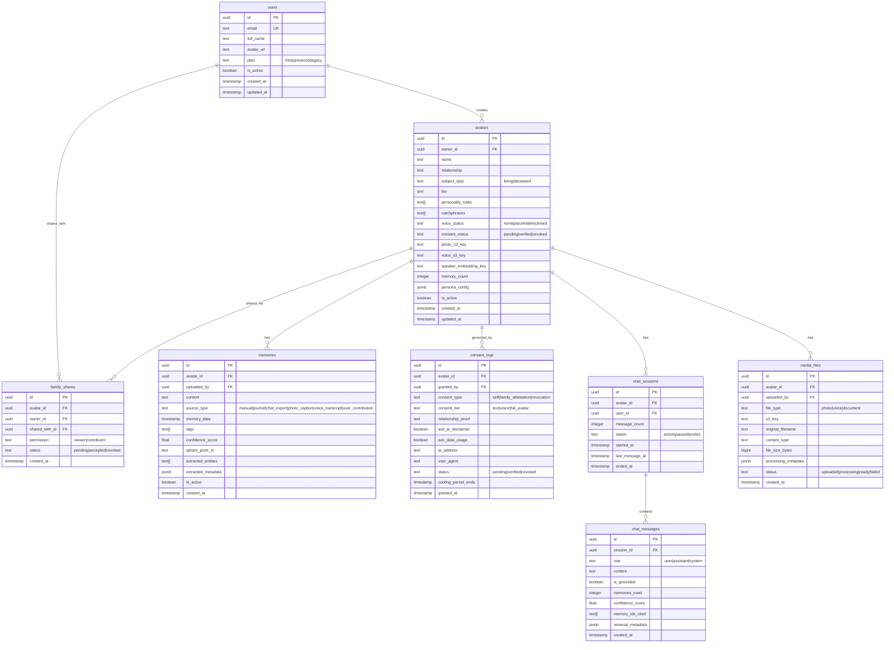
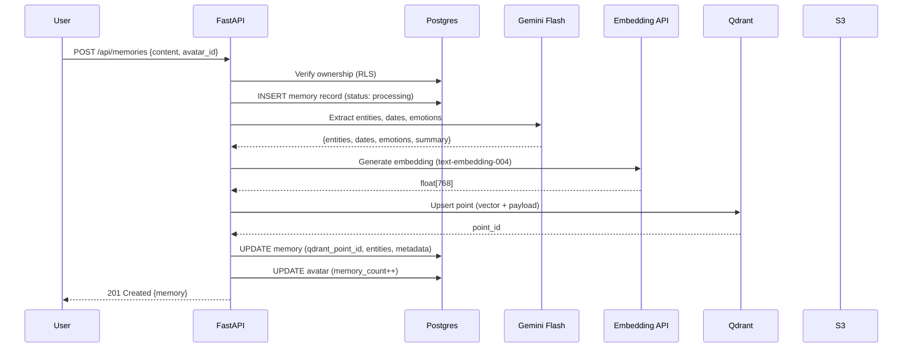
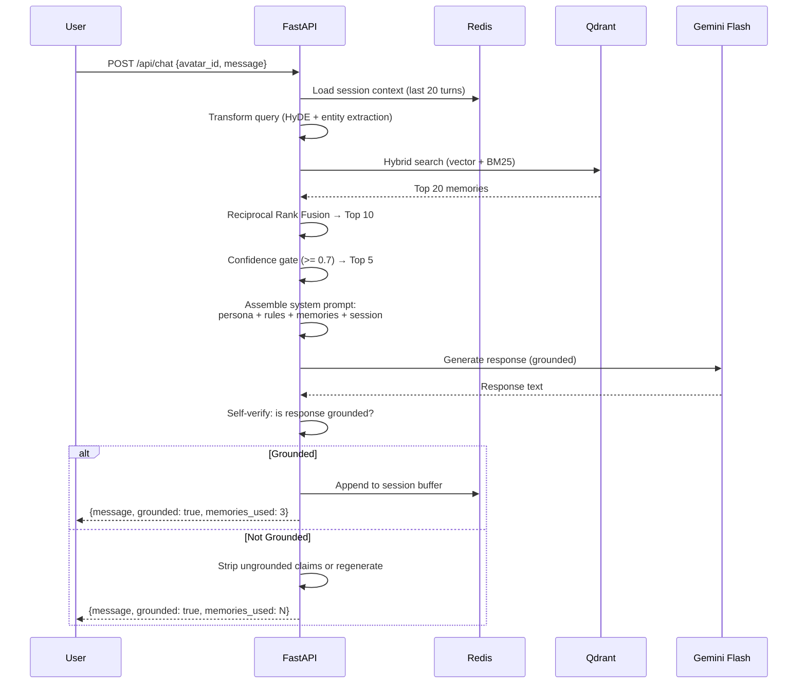
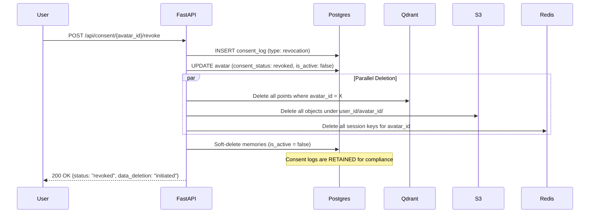

# Backend Schema — Eternia AI Companion Platform

> Complete data architecture covering Supabase Postgres tables, Qdrant vector collections, S3 storage layout, Redis cache keys, and full API contract reference.

---

## Table of Contents

1. [Database Schema (Supabase Postgres)](#1-database-schema-supabase-postgres)
2. [Row-Level Security Policies](#2-row-level-security-policies)
3. [Vector Store Schema (Qdrant)](#3-vector-store-schema-qdrant)
4. [Object Storage Layout (S3)](#4-object-storage-layout-s3)
5. [Session Cache Schema (Redis)](#5-session-cache-schema-redis)
6. [API Contract Reference](#6-api-contract-reference)
7. [Data Flow Diagrams](#7-data-flow-diagrams)

---

## 1. Database Schema (Supabase Postgres)

### 1.1 Entity Relationship Diagram



### 1.2 Table Definitions (SQL)

```sql
-- ============================================================
-- EXTENSION SETUP
-- ============================================================
CREATE EXTENSION IF NOT EXISTS "uuid-ossp";
CREATE EXTENSION IF NOT EXISTS "pgcrypto";

-- ============================================================
-- USERS
-- ============================================================
-- Extends Supabase auth.users with app-specific profile data.
-- Linked via auth.users.id = public.users.id
-- ============================================================
CREATE TABLE public.users (
    id              UUID PRIMARY KEY REFERENCES auth.users(id) ON DELETE CASCADE,
    email           TEXT UNIQUE NOT NULL,
    full_name       TEXT,
    avatar_url      TEXT,
    plan            TEXT NOT NULL DEFAULT 'free' CHECK (plan IN ('free', 'presence', 'legacy')),
    is_active       BOOLEAN NOT NULL DEFAULT TRUE,
    created_at      TIMESTAMPTZ NOT NULL DEFAULT NOW(),
    updated_at      TIMESTAMPTZ NOT NULL DEFAULT NOW()
);

-- Auto-create profile on signup via Supabase trigger
CREATE OR REPLACE FUNCTION public.handle_new_user()
RETURNS TRIGGER AS $$
BEGIN
    INSERT INTO public.users (id, email, full_name)
    VALUES (
        NEW.id,
        NEW.email,
        NEW.raw_user_meta_data ->> 'full_name'
    );
    RETURN NEW;
END;
$$ LANGUAGE plpgsql SECURITY DEFINER;

CREATE TRIGGER on_auth_user_created
    AFTER INSERT ON auth.users
    FOR EACH ROW EXECUTE FUNCTION public.handle_new_user();

-- ============================================================
-- AVATARS
-- ============================================================
CREATE TABLE public.avatars (
    id                   UUID PRIMARY KEY DEFAULT uuid_generate_v4(),
    owner_id             UUID NOT NULL REFERENCES public.users(id) ON DELETE CASCADE,
    name                 TEXT NOT NULL CHECK (char_length(name) BETWEEN 1 AND 100),
    relationship         TEXT NOT NULL,
    subject_type         TEXT NOT NULL CHECK (subject_type IN ('living', 'deceased')),
    bio                  TEXT CHECK (char_length(bio) <= 2000),
    personality_traits   TEXT[] DEFAULT '{}',
    catchphrases         TEXT[] DEFAULT '{}',
    voice_status         TEXT NOT NULL DEFAULT 'none' CHECK (voice_status IN ('none', 'placeholder', 'cloned')),
    consent_status       TEXT NOT NULL DEFAULT 'pending' CHECK (consent_status IN ('pending', 'verified', 'revoked')),
    photo_s3_key         TEXT,
    voice_s3_key         TEXT,
    speaker_embedding_key TEXT,
    memory_count         INTEGER NOT NULL DEFAULT 0,
    persona_config       JSONB DEFAULT '{}',
    is_active            BOOLEAN NOT NULL DEFAULT TRUE,
    created_at           TIMESTAMPTZ NOT NULL DEFAULT NOW(),
    updated_at           TIMESTAMPTZ NOT NULL DEFAULT NOW()
);

CREATE INDEX idx_avatars_owner ON public.avatars(owner_id);
CREATE INDEX idx_avatars_active ON public.avatars(is_active) WHERE is_active = TRUE;

-- ============================================================
-- MEMORIES
-- ============================================================
CREATE TABLE public.memories (
    id                  UUID PRIMARY KEY DEFAULT uuid_generate_v4(),
    avatar_id           UUID NOT NULL REFERENCES public.avatars(id) ON DELETE CASCADE,
    uploaded_by         UUID NOT NULL REFERENCES public.users(id),
    content             TEXT NOT NULL CHECK (char_length(content) BETWEEN 1 AND 10000),
    source_type         TEXT NOT NULL DEFAULT 'manual'
                        CHECK (source_type IN (
                            'manual', 'journal', 'chat_export',
                            'photo_caption', 'voice_transcript', 'user_contributed'
                        )),
    memory_date         TIMESTAMPTZ,
    tags                TEXT[] DEFAULT '{}',
    confidence_score    FLOAT NOT NULL DEFAULT 1.0 CHECK (confidence_score BETWEEN 0.0 AND 1.0),
    qdrant_point_id     TEXT,
    extracted_entities  TEXT[] DEFAULT '{}',
    extracted_metadata  JSONB DEFAULT '{}',
    is_active           BOOLEAN NOT NULL DEFAULT TRUE,
    created_at          TIMESTAMPTZ NOT NULL DEFAULT NOW()
);

CREATE INDEX idx_memories_avatar ON public.memories(avatar_id);
CREATE INDEX idx_memories_source ON public.memories(source_type);
CREATE INDEX idx_memories_date ON public.memories(memory_date);

-- Trigger to update avatar.memory_count
CREATE OR REPLACE FUNCTION public.update_memory_count()
RETURNS TRIGGER AS $$
BEGIN
    IF TG_OP = 'INSERT' THEN
        UPDATE public.avatars SET memory_count = memory_count + 1, updated_at = NOW()
        WHERE id = NEW.avatar_id;
    ELSIF TG_OP = 'DELETE' OR (TG_OP = 'UPDATE' AND OLD.is_active = TRUE AND NEW.is_active = FALSE) THEN
        UPDATE public.avatars SET memory_count = memory_count - 1, updated_at = NOW()
        WHERE id = COALESCE(OLD.avatar_id, NEW.avatar_id);
    END IF;
    RETURN COALESCE(NEW, OLD);
END;
$$ LANGUAGE plpgsql SECURITY DEFINER;

CREATE TRIGGER on_memory_change
    AFTER INSERT OR UPDATE OR DELETE ON public.memories
    FOR EACH ROW EXECUTE FUNCTION public.update_memory_count();

-- ============================================================
-- CONSENT LOGS (Append-Only — NO UPDATE or DELETE allowed)
-- ============================================================
CREATE TABLE public.consent_logs (
    id                   UUID PRIMARY KEY DEFAULT uuid_generate_v4(),
    avatar_id            UUID NOT NULL REFERENCES public.avatars(id),
    granted_by           UUID NOT NULL REFERENCES public.users(id),
    consent_type         TEXT NOT NULL CHECK (consent_type IN ('self', 'family_attestation', 'revocation')),
    consent_tier         TEXT NOT NULL DEFAULT 'text' CHECK (consent_tier IN ('text', 'voice', 'full_avatar')),
    relationship_proof   TEXT,
    ack_ai_disclaimer    BOOLEAN NOT NULL DEFAULT FALSE,
    ack_data_usage       BOOLEAN NOT NULL DEFAULT FALSE,
    ip_address           INET,
    user_agent           TEXT,
    status               TEXT NOT NULL DEFAULT 'pending' CHECK (status IN ('pending', 'verified', 'revoked')),
    cooling_period_ends  TIMESTAMPTZ,
    granted_at           TIMESTAMPTZ NOT NULL DEFAULT NOW()
);

-- CRITICAL: Prevent UPDATE and DELETE on consent_logs
CREATE OR REPLACE FUNCTION public.prevent_consent_modification()
RETURNS TRIGGER AS $$
BEGIN
    RAISE EXCEPTION 'Consent logs are append-only. Modifications are not permitted.';
END;
$$ LANGUAGE plpgsql;

CREATE TRIGGER prevent_consent_update
    BEFORE UPDATE ON public.consent_logs
    FOR EACH ROW EXECUTE FUNCTION public.prevent_consent_modification();

CREATE TRIGGER prevent_consent_delete
    BEFORE DELETE ON public.consent_logs
    FOR EACH ROW EXECUTE FUNCTION public.prevent_consent_modification();

CREATE INDEX idx_consent_avatar ON public.consent_logs(avatar_id);

-- ============================================================
-- MEDIA FILES
-- ============================================================
CREATE TABLE public.media_files (
    id                   UUID PRIMARY KEY DEFAULT uuid_generate_v4(),
    avatar_id            UUID NOT NULL REFERENCES public.avatars(id) ON DELETE CASCADE,
    uploaded_by          UUID NOT NULL REFERENCES public.users(id),
    file_type            TEXT NOT NULL CHECK (file_type IN ('photo', 'voice', 'document')),
    s3_key               TEXT NOT NULL,
    original_filename    TEXT,
    content_type         TEXT,
    file_size_bytes      BIGINT CHECK (file_size_bytes >= 0),
    processing_metadata  JSONB DEFAULT '{}',
    status               TEXT NOT NULL DEFAULT 'uploaded'
                         CHECK (status IN ('uploaded', 'processing', 'ready', 'failed')),
    created_at           TIMESTAMPTZ NOT NULL DEFAULT NOW()
);

CREATE INDEX idx_media_avatar ON public.media_files(avatar_id);
CREATE INDEX idx_media_type ON public.media_files(file_type);

-- ============================================================
-- CHAT SESSIONS
-- ============================================================
CREATE TABLE public.chat_sessions (
    id                UUID PRIMARY KEY DEFAULT uuid_generate_v4(),
    avatar_id         UUID NOT NULL REFERENCES public.avatars(id) ON DELETE CASCADE,
    user_id           UUID NOT NULL REFERENCES public.users(id),
    message_count     INTEGER NOT NULL DEFAULT 0,
    status            TEXT NOT NULL DEFAULT 'active' CHECK (status IN ('active', 'paused', 'ended')),
    started_at        TIMESTAMPTZ NOT NULL DEFAULT NOW(),
    last_message_at   TIMESTAMPTZ,
    ended_at          TIMESTAMPTZ
);

CREATE INDEX idx_sessions_avatar ON public.chat_sessions(avatar_id);
CREATE INDEX idx_sessions_user ON public.chat_sessions(user_id);

-- ============================================================
-- CHAT MESSAGES
-- ============================================================
CREATE TABLE public.chat_messages (
    id                 UUID PRIMARY KEY DEFAULT uuid_generate_v4(),
    session_id         UUID NOT NULL REFERENCES public.chat_sessions(id) ON DELETE CASCADE,
    role               TEXT NOT NULL CHECK (role IN ('user', 'assistant', 'system')),
    content            TEXT NOT NULL,
    is_grounded        BOOLEAN DEFAULT TRUE,
    memories_used      INTEGER DEFAULT 0,
    confidence_score   FLOAT CHECK (confidence_score BETWEEN 0.0 AND 1.0),
    memory_ids_cited   TEXT[] DEFAULT '{}',
    retrieval_metadata JSONB DEFAULT '{}',
    created_at         TIMESTAMPTZ NOT NULL DEFAULT NOW()
);

CREATE INDEX idx_messages_session ON public.chat_messages(session_id);
CREATE INDEX idx_messages_created ON public.chat_messages(created_at);

-- ============================================================
-- FAMILY SHARES
-- ============================================================
CREATE TABLE public.family_shares (
    id              UUID PRIMARY KEY DEFAULT uuid_generate_v4(),
    avatar_id       UUID NOT NULL REFERENCES public.avatars(id) ON DELETE CASCADE,
    owner_id        UUID NOT NULL REFERENCES public.users(id),
    shared_with_id  UUID NOT NULL REFERENCES public.users(id),
    permission      TEXT NOT NULL DEFAULT 'viewer' CHECK (permission IN ('viewer', 'contributor')),
    status          TEXT NOT NULL DEFAULT 'pending' CHECK (status IN ('pending', 'accepted', 'revoked')),
    created_at      TIMESTAMPTZ NOT NULL DEFAULT NOW(),
    UNIQUE(avatar_id, shared_with_id)
);

CREATE INDEX idx_shares_avatar ON public.family_shares(avatar_id);
CREATE INDEX idx_shares_shared_with ON public.family_shares(shared_with_id);
```

---

## 2. Row-Level Security Policies

```sql
-- Enable RLS on all tables
ALTER TABLE public.users ENABLE ROW LEVEL SECURITY;
ALTER TABLE public.avatars ENABLE ROW LEVEL SECURITY;
ALTER TABLE public.memories ENABLE ROW LEVEL SECURITY;
ALTER TABLE public.consent_logs ENABLE ROW LEVEL SECURITY;
ALTER TABLE public.media_files ENABLE ROW LEVEL SECURITY;
ALTER TABLE public.chat_sessions ENABLE ROW LEVEL SECURITY;
ALTER TABLE public.chat_messages ENABLE ROW LEVEL SECURITY;
ALTER TABLE public.family_shares ENABLE ROW LEVEL SECURITY;

-- ============================================================
-- USERS: Users can only read/update their own profile
-- ============================================================
CREATE POLICY "Users can view own profile"
    ON public.users FOR SELECT
    USING (auth.uid() = id);

CREATE POLICY "Users can update own profile"
    ON public.users FOR UPDATE
    USING (auth.uid() = id);

-- ============================================================
-- AVATARS: Owner + shared family members can access
-- ============================================================
CREATE POLICY "Owners can CRUD own avatars"
    ON public.avatars FOR ALL
    USING (auth.uid() = owner_id);

CREATE POLICY "Shared users can view avatars"
    ON public.avatars FOR SELECT
    USING (
        id IN (
            SELECT avatar_id FROM public.family_shares
            WHERE shared_with_id = auth.uid() AND status = 'accepted'
        )
    );

-- ============================================================
-- MEMORIES: Owner + contributors can access
-- ============================================================
CREATE POLICY "Owners can CRUD memories"
    ON public.memories FOR ALL
    USING (
        avatar_id IN (
            SELECT id FROM public.avatars WHERE owner_id = auth.uid()
        )
    );

CREATE POLICY "Contributors can add memories"
    ON public.memories FOR INSERT
    WITH CHECK (
        avatar_id IN (
            SELECT avatar_id FROM public.family_shares
            WHERE shared_with_id = auth.uid()
            AND permission = 'contributor'
            AND status = 'accepted'
        )
    );

CREATE POLICY "Shared users can view memories"
    ON public.memories FOR SELECT
    USING (
        avatar_id IN (
            SELECT avatar_id FROM public.family_shares
            WHERE shared_with_id = auth.uid() AND status = 'accepted'
        )
    );

-- ============================================================
-- CONSENT LOGS: Only owner can insert, anyone can view for their avatar
-- ============================================================
CREATE POLICY "Owners can insert consent logs"
    ON public.consent_logs FOR INSERT
    WITH CHECK (auth.uid() = granted_by);

CREATE POLICY "Owners can view consent logs"
    ON public.consent_logs FOR SELECT
    USING (
        avatar_id IN (
            SELECT id FROM public.avatars WHERE owner_id = auth.uid()
        )
    );

-- ============================================================
-- CHAT: Only session owner can access messages
-- ============================================================
CREATE POLICY "Users can CRUD own sessions"
    ON public.chat_sessions FOR ALL
    USING (auth.uid() = user_id);

CREATE POLICY "Users can access own session messages"
    ON public.chat_messages FOR ALL
    USING (
        session_id IN (
            SELECT id FROM public.chat_sessions WHERE user_id = auth.uid()
        )
    );
```

---

## 3. Vector Store Schema (Qdrant)

### 3.1 Collection: `memories`

```json
{
    "collection_name": "memories",
    "vectors_config": {
        "size": 768,
        "distance": "Cosine"
    },
    "optimizers_config": {
        "indexing_threshold": 20000
    },
    "on_disk_payload": true
}
```

### 3.2 Point Payload Schema

Every vector point in Qdrant stores this metadata payload:

```json
{
    "user_id":          "uuid — namespace isolation (MANDATORY filter)",
    "avatar_id":        "uuid — which avatar this memory belongs to",
    "memory_id":        "uuid — FK back to Postgres memories table",
    "content":          "string — original memory text (for BM25 keyword search)",
    "source_type":      "string — manual|journal|chat_export|...",
    "memory_date":      "string|null — ISO 8601 date when memory occurred",
    "confidence_score": "float — 0.0 to 1.0",
    "tags":             ["string array — user-provided tags"],
    "entities":         ["string array — extracted named entities"],
    "chunk_index":      "int — for multi-chunk memories, which chunk this is",
    "total_chunks":     "int — total chunks for this memory"
}
```

### 3.3 Required Indexes

```json
{
    "field_name": "user_id",
    "field_schema": "Keyword"
}
```
```json
{
    "field_name": "avatar_id",
    "field_schema": "Keyword"
}
```
```json
{
    "field_name": "confidence_score",
    "field_schema": "Float"
}
```
```json
{
    "field_name": "content",
    "field_schema": {
        "type": "Text",
        "tokenizer": "word",
        "min_token_len": 2,
        "max_token_len": 20,
        "lowercase": true
    }
}
```

### 3.4 Search Strategy

```
EVERY search query MUST include these filters:
  - user_id == authenticated_user.id   (privacy isolation)
  - avatar_id == target_avatar.id      (scope to specific avatar)

Search pipeline:
  1. Dense vector search (semantic similarity) → Top 20
  2. BM25 keyword search on "content" field → Top 20
  3. Reciprocal Rank Fusion to merge → Top 10
  4. Filter: confidence_score >= 0.7
  5. Return Top 5 for LLM context injection
```

---

## 4. Object Storage Layout (S3)

### 4.1 Bucket Structure

```
eternia-uploads/
├── {user_id}/
│   ├── {avatar_id}/
│   │   ├── photos/
│   │   │   ├── {uuid}.jpg         # Reference photos
│   │   │   ├── {uuid}.png
│   │   │   └── {uuid}_face.jpg    # Auto-cropped face region
│   │   ├── voice/
│   │   │   ├── {uuid}.wav         # Original recordings
│   │   │   ├── {uuid}_clean.wav   # Noise-reduced version
│   │   │   └── embedding.bin      # Cached speaker embedding
│   │   └── documents/
│   │       ├── {uuid}.txt         # Uploaded journals
│   │       ├── {uuid}.pdf         # Scanned documents
│   │       └── {uuid}.json        # Parsed chat exports
│   └── exports/
│       └── {timestamp}_export.zip # User data export files
```

### 4.2 Encryption & Access Rules

| Property | Value |
|:---|:---|
| **Server-Side Encryption** | AES-256 (SSE-S3) |
| **Access** | Private (no public access) |
| **Access Method** | Presigned URLs only (1-hour expiry) |
| **Lifecycle** | No auto-deletion; manual via consent revocation |
| **Versioning** | Disabled (save costs; no need for version history) |
| **CORS** | Restricted to app domains only |

---

## 5. Session Cache Schema (Redis)

### 5.1 Key Patterns

```
# Session conversation buffer (last 20 turns)
session:{user_id}:{avatar_id}:messages    → List<JSON>    TTL: 24h

# User's emotional state tracking
session:{user_id}:{avatar_id}:emotion     → JSON           TTL: 24h

# Speaker embedding cache (avoid re-fetching from S3)
cache:voice:{avatar_id}:embedding         → Binary          TTL: 7d

# Persona prompt cache (avoid re-assembling)
cache:persona:{avatar_id}:prompt          → String          TTL: 1h

# Rate limiting
ratelimit:{user_id}:chat                  → Counter         TTL: 60s
ratelimit:{user_id}:upload                → Counter         TTL: 300s
```

### 5.2 Session Message Format

```json
{
    "role": "user|assistant",
    "content": "message text",
    "timestamp": "2026-09-05T12:00:00Z",
    "is_grounded": true,
    "memories_used": 3
}
```

---

## 6. API Contract Reference

### 6.1 Authentication

All endpoints (except `/health`) require a Bearer token in the `Authorization` header:

```
Authorization: Bearer <supabase_jwt_token>
```

### 6.2 Endpoints

#### Health

| Method | Path | Auth | Description |
|:---|:---|:---|:---|
| `GET` | `/health` | ❌ | Service health check |

#### Avatars

| Method | Path | Auth | Description |
|:---|:---|:---|:---|
| `POST` | `/api/avatars` | ✅ | Create a new avatar |
| `GET` | `/api/avatars` | ✅ | List user's avatars |
| `GET` | `/api/avatars/{id}` | ✅ | Get avatar details |
| `PATCH` | `/api/avatars/{id}` | ✅ | Update avatar (bio, traits, etc.) |
| `DELETE` | `/api/avatars/{id}` | ✅ | Delete avatar + all data |
| `POST` | `/api/avatars/{id}/photo` | ✅ | Upload reference photo (multipart) |
| `POST` | `/api/avatars/{id}/voice` | ✅ | Upload voice recording (multipart) |

#### Memories

| Method | Path | Auth | Description |
|:---|:---|:---|:---|
| `POST` | `/api/memories` | ✅ | Add a single memory |
| `GET` | `/api/memories/{avatar_id}` | ✅ | List memories for avatar |
| `POST` | `/api/memories/{avatar_id}/import` | ✅ | Bulk import from file |
| `DELETE` | `/api/memories/{memory_id}` | ✅ | Delete a specific memory |
| `GET` | `/api/memories/{avatar_id}/stats` | ✅ | Memory count, sources breakdown |

#### Chat

| Method | Path | Auth | Description |
|:---|:---|:---|:---|
| `POST` | `/api/chat` | ✅ | Send message, get grounded response |
| `GET` | `/api/chat/{avatar_id}/history` | ✅ | Get chat history |
| `DELETE` | `/api/chat/{avatar_id}/history` | ✅ | Clear chat history |

#### Consent

| Method | Path | Auth | Description |
|:---|:---|:---|:---|
| `POST` | `/api/consent` | ✅ | Record consent (self or family) |
| `GET` | `/api/consent/{avatar_id}` | ✅ | Get consent status |
| `POST` | `/api/consent/{avatar_id}/revoke` | ✅ | Revoke consent + trigger deletion |

#### Data Export

| Method | Path | Auth | Description |
|:---|:---|:---|:---|
| `POST` | `/api/export/{avatar_id}` | ✅ | Generate data export ZIP |
| `GET` | `/api/export/{avatar_id}/download` | ✅ | Download latest export |

### 6.3 Error Response Format

All errors follow a consistent shape:

```json
{
    "error": {
        "code": "AVATAR_NOT_FOUND",
        "message": "No avatar found with the given ID.",
        "status": 404,
        "details": {}
    }
}
```

#### Error Codes

| Code | HTTP | Description |
|:---|:---|:---|
| `UNAUTHORIZED` | 401 | Missing or invalid JWT |
| `FORBIDDEN` | 403 | User doesn't own this resource |
| `AVATAR_NOT_FOUND` | 404 | Avatar doesn't exist or is inactive |
| `MEMORY_NOT_FOUND` | 404 | Memory doesn't exist |
| `CONSENT_REQUIRED` | 403 | Avatar hasn't passed consent verification |
| `CONSENT_REVOKED` | 403 | Consent was revoked; avatar is deactivated |
| `COOLING_PERIOD` | 403 | Deceased avatar still in 72h cooling period |
| `RATE_LIMITED` | 429 | Too many requests |
| `FILE_TOO_LARGE` | 413 | Upload exceeds size limit |
| `INVALID_FILE_TYPE` | 400 | Unsupported file format |
| `MEMORY_LIMIT` | 403 | Free plan memory limit (50) reached |
| `PLAN_REQUIRED` | 403 | Feature requires a paid plan |

---

## 7. Data Flow Diagrams

### 7.1 Memory Ingestion Flow



### 7.2 Chat Conversation Flow



### 7.3 Consent Revocation Flow


