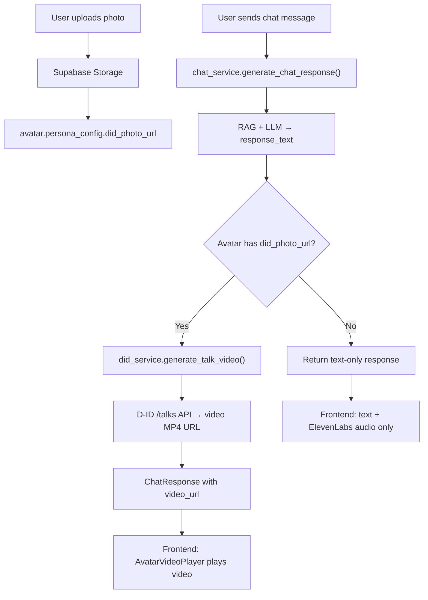

# D-ID Talking Avatar Integration Plan — Eternia AI Companion

> **Objective:** Integrate D-ID's Talks API to generate photorealistic talking-head avatar videos from a user-uploaded photo and AI-generated text responses, displayed inline in the chat UI and the live video call modal.
>
> **D-ID Free Trial:** 14-day trial with ~3 minutes of generated video (enough for prototyping and demo). Paid plans start at ~$18/month (Build tier).
>
> **Architecture:** Asynchronous video generation via D-ID `/talks` endpoint. User uploads a photo → photo is stored → when AI responds with text, backend sends photo + text to D-ID → D-ID returns a talking-head MP4 video → frontend plays it inline.

---

## Table of Contents

1. [Prerequisites & Setup](#1-prerequisites--setup)
2. [Phase 1: Backend — D-ID Service Layer](#2-phase-1-backend--d-id-service-layer)
3. [Phase 2: Backend — API Routes](#3-phase-2-backend--api-routes)
4. [Phase 3: Backend — Chat Pipeline Integration](#4-phase-3-backend--chat-pipeline-integration)
5. [Phase 4: Frontend — Photo Upload Flow](#5-phase-4-frontend--photo-upload-flow)
6. [Phase 5: Frontend — Avatar Video Player Component](#6-phase-5-frontend--avatar-video-player-component)
7. [Phase 6: Frontend — Chat Integration](#7-phase-6-frontend--chat-integration)
8. [Phase 7: Frontend — Live Video Call Modal Integration](#8-phase-7-frontend--live-video-call-modal-integration)
9. [Phase 8: Testing & Polish](#9-phase-8-testing--polish)
10. [File Map & Dependency Graph](#10-file-map--dependency-graph)
11. [Agent Delegation Prompt](#11-agent-delegation-prompt)

---

## 1. Prerequisites & Setup

### 1.1 Get D-ID API Key
1. Sign up at [https://studio.d-id.com/](https://studio.d-id.com/)
2. Go to **Settings → API** (or [https://studio.d-id.com/account](https://studio.d-id.com/account))
3. Copy your **API Key** (it's a Base64-encoded string used as `Basic <key>` in the Authorization header)
4. Add to `backend/.env`:
   ```env
   # D-ID Talking Avatar API
   DID_API_KEY="your_d_id_api_key_here"
   DID_API_URL="https://api.d-id.com"
   ```

### 1.2 Install Backend Dependencies
No new pip packages needed — we already use `httpx` (for ElevenLabs) which works perfectly for D-ID too.

### 1.3 Install Frontend Dependencies
No new npm packages needed — we use native `<video>` elements and existing fetch-based API client.

### 1.4 Photo Storage Strategy
Avatar source photos will be stored in **Supabase Storage** (bucket: `avatar-photos`). The photo URL is passed to D-ID as `source_url`. Supabase Storage provides public URLs that D-ID can fetch from.

**Supabase Storage Setup:**
```sql
-- Run in Supabase SQL Editor
INSERT INTO storage.buckets (id, name, public)
VALUES ('avatar-photos', 'avatar-photos', true)
ON CONFLICT (id) DO NOTHING;

-- Allow authenticated users to upload to their own folder
CREATE POLICY "Users can upload avatar photos"
ON storage.objects FOR INSERT
WITH CHECK (
  bucket_id = 'avatar-photos'
  AND auth.role() = 'authenticated'
);

-- Allow public read access for D-ID to fetch the image
CREATE POLICY "Public read access for avatar photos"
ON storage.objects FOR SELECT
USING (bucket_id = 'avatar-photos');
```

---

## 2. Phase 1: Backend — D-ID Service Layer

### File: `backend/app/services/did_service.py`

This is the core service that communicates with the D-ID API.

```python
"""D-ID Talks API service for generating photorealistic talking avatar videos."""

import asyncio
import logging
from typing import Optional, Dict, Any
import httpx
from backend.app.core.config import settings

logger = logging.getLogger(__name__)

# In-memory cache for recently generated video URLs (talk_id -> result_url)
# Keeps the last 50 results to avoid re-polling completed talks
_VIDEO_CACHE: Dict[str, str] = {}
MAX_VIDEO_CACHE = 50


class DIDService:
    """Service for generating talking avatar videos via D-ID Talks API."""

    def __init__(self):
        self.api_url = settings.DID_API_URL or "https://api.d-id.com"
        self.max_poll_attempts = 30  # Max polling attempts (30 * 2s = 60s timeout)
        self.poll_interval = 2.0     # Seconds between poll requests

    def _get_headers(self) -> Dict[str, str]:
        """Build authorization headers for D-ID API."""
        key = settings.DID_API_KEY
        if not key:
            raise ValueError("DID_API_KEY is not configured in backend settings.")
        return {
            "Authorization": f"Basic {key}",
            "Content-Type": "application/json",
            "Accept": "application/json",
        }

    async def create_talk(
        self,
        source_url: str,
        text: str,
        voice_provider: str = "microsoft",
        voice_id: str = "en-US-JennyNeural",
        driver_url: Optional[str] = None,
    ) -> Dict[str, Any]:
        """Create a new talking avatar video via D-ID Talks API.

        Args:
            source_url: Public URL of the source face photo.
            text: The text the avatar should speak.
            voice_provider: TTS provider ("microsoft", "amazon", "elevenlabs").
            voice_id: Voice ID for the selected provider.
            driver_url: Optional driver video URL for specific expressions/movements.

        Returns:
            Dict with 'id' (talk ID) and 'status' keys.
        """
        endpoint = f"{self.api_url}/talks"
        headers = self._get_headers()

        payload = {
            "source_url": source_url,
            "script": {
                "type": "text",
                "input": text[:500],  # D-ID has text length limits
                "provider": {
                    "type": voice_provider,
                    "voice_id": voice_id,
                },
            },
            "config": {
                "stitch": True,  # Better quality stitching
            },
        }

        if driver_url:
            payload["driver_url"] = driver_url

        logger.info(
            "Creating D-ID talk: %d chars, voice=%s/%s",
            len(text), voice_provider, voice_id,
        )

        async with httpx.AsyncClient(timeout=30.0) as client:
            resp = await client.post(endpoint, headers=headers, json=payload)

            if resp.status_code not in (200, 201):
                logger.error(
                    "D-ID create talk failed [%d]: %s",
                    resp.status_code, resp.text,
                )
                raise RuntimeError(
                    f"D-ID API error [{resp.status_code}]: {resp.text}"
                )

            result = resp.json()
            logger.info("D-ID talk created: id=%s, status=%s", result.get("id"), result.get("status"))
            return result

    async def get_talk_status(self, talk_id: str) -> Dict[str, Any]:
        """Poll D-ID for the status/result of a talk video.

        Args:
            talk_id: The talk ID returned from create_talk.

        Returns:
            Dict with 'status', and when done, 'result_url'.
        """
        endpoint = f"{self.api_url}/talks/{talk_id}"
        headers = self._get_headers()

        async with httpx.AsyncClient(timeout=15.0) as client:
            resp = await client.get(endpoint, headers=headers)

            if resp.status_code != 200:
                logger.error(
                    "D-ID get talk status failed [%d]: %s",
                    resp.status_code, resp.text,
                )
                raise RuntimeError(
                    f"D-ID status check failed [{resp.status_code}]: {resp.text}"
                )

            return resp.json()

    async def generate_talk_video(
        self,
        source_url: str,
        text: str,
        voice_provider: str = "microsoft",
        voice_id: str = "en-US-JennyNeural",
    ) -> str:
        """Full pipeline: create talk → poll until done → return video URL.

        This is the primary method to call from the chat pipeline.

        Args:
            source_url: Public URL of the avatar's face photo.
            text: Text for the avatar to speak.
            voice_provider: TTS provider.
            voice_id: Voice ID.

        Returns:
            result_url: Direct URL to the MP4 video (valid ~24 hours).

        Raises:
            RuntimeError: If generation fails or times out.
            TimeoutError: If polling exceeds max attempts.
        """
        # 1. Create the talk
        talk_data = await self.create_talk(
            source_url=source_url,
            text=text,
            voice_provider=voice_provider,
            voice_id=voice_id,
        )
        talk_id = talk_data.get("id")
        if not talk_id:
            raise RuntimeError("D-ID returned no talk ID")

        # 2. Poll for completion
        for attempt in range(self.max_poll_attempts):
            await asyncio.sleep(self.poll_interval)

            status_data = await self.get_talk_status(talk_id)
            status = status_data.get("status", "unknown")

            logger.info(
                "D-ID talk %s poll #%d: status=%s",
                talk_id, attempt + 1, status,
            )

            if status == "done":
                result_url = status_data.get("result_url")
                if not result_url:
                    raise RuntimeError("D-ID talk done but no result_url returned")

                # Cache the result
                _VIDEO_CACHE[talk_id] = result_url
                if len(_VIDEO_CACHE) > MAX_VIDEO_CACHE:
                    # Remove oldest entry
                    oldest_key = next(iter(_VIDEO_CACHE))
                    del _VIDEO_CACHE[oldest_key]

                logger.info("D-ID talk %s completed: %s", talk_id, result_url)
                return result_url

            elif status in ("error", "rejected"):
                error_msg = status_data.get("error", {}).get("description", "Unknown error")
                raise RuntimeError(f"D-ID talk failed: {error_msg}")

        raise TimeoutError(
            f"D-ID talk {talk_id} did not complete within {self.max_poll_attempts * self.poll_interval}s"
        )

    async def get_remaining_credits(self) -> Dict[str, Any]:
        """Check remaining D-ID API credits/quota.

        Returns:
            Dict with credit information.
        """
        endpoint = f"{self.api_url}/credits"
        headers = self._get_headers()

        async with httpx.AsyncClient(timeout=10.0) as client:
            resp = await client.get(endpoint, headers=headers)
            if resp.status_code != 200:
                logger.warning("Could not fetch D-ID credits: %s", resp.text)
                return {"remaining": "unknown", "total": "unknown"}
            return resp.json()


# Singleton instance
did_service = DIDService()
```

---

## 3. Phase 2: Backend — API Routes

### File: `backend/app/api/routes/did_avatar.py`

```python
"""API route handlers for D-ID talking avatar video generation."""

import logging
import uuid
from typing import Optional
from fastapi import APIRouter, Depends, HTTPException, UploadFile, File, status
from pydantic import BaseModel, Field

from backend.app.core.auth import get_current_user
from backend.app.core.errors import AvatarNotFoundError, ForbiddenError
from backend.app.models.database import get_supabase_admin_client
from backend.app.services.did_service import did_service

logger = logging.getLogger(__name__)

router = APIRouter(prefix="/did-avatar", tags=["D-ID Avatar"])


# ─── Request / Response Schemas ───────────────────────────────────────────────

class GenerateTalkRequest(BaseModel):
    text: str = Field(..., min_length=1, max_length=500, description="Text for the avatar to speak")
    voice_provider: str = Field("microsoft", description="TTS provider: microsoft, amazon, elevenlabs")
    voice_id: str = Field("en-US-JennyNeural", description="Voice ID for the provider")


class GenerateTalkResponse(BaseModel):
    video_url: str
    talk_id: str
    duration_estimate: Optional[float] = None


class AvatarPhotoResponse(BaseModel):
    avatar_id: str
    photo_url: str
    message: str


class CreditsResponse(BaseModel):
    remaining: str
    total: str


# ─── Endpoints ────────────────────────────────────────────────────────────────

@router.post("/{avatar_id}/upload-photo", response_model=AvatarPhotoResponse)
async def upload_avatar_photo(
    avatar_id: str,
    file: UploadFile = File(..., description="Face photo for the avatar (JPG/PNG, clear front-facing)"),
    current_user: dict = Depends(get_current_user),
):
    """Upload a face photo for an avatar. Stored in Supabase Storage.

    The photo must be:
    - Clear, front-facing portrait
    - JPG or PNG format
    - At least 256x256 pixels (512x512+ recommended)
    - Well-lit with minimal obstructions
    """
    db = get_supabase_admin_client()

    # Verify avatar exists and user owns it
    res = db.table("avatars").select("owner_id").eq("id", avatar_id).execute()
    if not res.data:
        raise AvatarNotFoundError(avatar_id)
    if res.data[0]["owner_id"] != current_user["id"]:
        raise ForbiddenError("You do not own this avatar.")

    # Validate file type
    allowed_types = ["image/jpeg", "image/png", "image/jpg"]
    if file.content_type not in allowed_types:
        raise HTTPException(
            status_code=status.HTTP_400_BAD_REQUEST,
            detail=f"Invalid file type '{file.content_type}'. Must be JPG or PNG.",
        )

    # Read file bytes
    file_bytes = await file.read()
    if len(file_bytes) > 10 * 1024 * 1024:  # 10MB limit
        raise HTTPException(
            status_code=status.HTTP_400_BAD_REQUEST,
            detail="Photo must be under 10MB.",
        )

    # Generate unique filename
    ext = "jpg" if "jpeg" in (file.content_type or "") or "jpg" in (file.content_type or "") else "png"
    storage_path = f"{current_user['id']}/{avatar_id}/face.{ext}"

    # Upload to Supabase Storage
    try:
        storage = db.storage.from_("avatar-photos")

        # Delete existing photo if any (overwrite)
        try:
            storage.remove([storage_path])
        except Exception:
            pass  # File might not exist yet

        storage.upload(
            path=storage_path,
            file=file_bytes,
            file_options={"content-type": file.content_type, "upsert": "true"},
        )

        # Get public URL
        public_url = storage.get_public_url(storage_path)

        # Update avatar record with photo reference
        # First fetch existing persona_config to merge
        existing = db.table("avatars").select("persona_config").eq("id", avatar_id).execute()
        existing_config = (existing.data[0].get("persona_config") or {}) if existing.data else {}
        existing_config["did_photo_url"] = public_url

        db.table("avatars").update({
            "photo_s3_key": storage_path,
            "persona_config": existing_config,
        }).eq("id", avatar_id).execute()

        logger.info("Avatar photo uploaded: %s -> %s", avatar_id, storage_path)

        return AvatarPhotoResponse(
            avatar_id=avatar_id,
            photo_url=public_url,
            message="Photo uploaded successfully. Your avatar is ready for video generation.",
        )

    except Exception as exc:
        logger.error("Photo upload failed for avatar %s: %s", avatar_id, exc)
        raise HTTPException(
            status_code=status.HTTP_500_INTERNAL_SERVER_ERROR,
            detail=f"Failed to upload photo: {str(exc)}",
        )


@router.get("/{avatar_id}/photo-url")
async def get_avatar_photo_url(
    avatar_id: str,
    current_user: dict = Depends(get_current_user),
):
    """Get the public URL of an avatar's uploaded face photo."""
    db = get_supabase_admin_client()

    res = db.table("avatars").select("*").eq("id", avatar_id).execute()
    if not res.data:
        raise AvatarNotFoundError(avatar_id)

    avatar = res.data[0]
    persona_config = avatar.get("persona_config") or {}
    photo_url = persona_config.get("did_photo_url")

    if not photo_url:
        raise HTTPException(
            status_code=status.HTTP_404_NOT_FOUND,
            detail="No photo uploaded for this avatar. Upload one via POST /did-avatar/{id}/upload-photo",
        )

    return {"avatar_id": avatar_id, "photo_url": photo_url}


@router.post("/{avatar_id}/generate-talk", response_model=GenerateTalkResponse)
async def generate_talking_video(
    avatar_id: str,
    payload: GenerateTalkRequest,
    current_user: dict = Depends(get_current_user),
):
    """Generate a talking avatar video for the given text.

    Flow: Fetches the avatar's stored photo URL → sends to D-ID → polls for completion → returns video URL.

    The returned video_url is a direct link to an MP4 file (valid ~24 hours).
    """
    db = get_supabase_admin_client()

    # Fetch avatar and verify ownership
    res = db.table("avatars").select("*").eq("id", avatar_id).execute()
    if not res.data:
        raise AvatarNotFoundError(avatar_id)

    avatar = res.data[0]
    if avatar["owner_id"] != current_user["id"]:
        raise ForbiddenError("You do not own this avatar.")

    # Get photo URL from persona_config
    persona_config = avatar.get("persona_config") or {}
    photo_url = persona_config.get("did_photo_url")

    if not photo_url:
        raise HTTPException(
            status_code=status.HTTP_400_BAD_REQUEST,
            detail="No face photo uploaded for this avatar. Upload one first via POST /did-avatar/{id}/upload-photo",
        )

    try:
        video_url = await did_service.generate_talk_video(
            source_url=photo_url,
            text=payload.text,
            voice_provider=payload.voice_provider,
            voice_id=payload.voice_id,
        )

        return GenerateTalkResponse(
            video_url=video_url,
            talk_id=avatar_id,
        )

    except TimeoutError as exc:
        logger.error("D-ID video generation timed out for avatar %s: %s", avatar_id, exc)
        raise HTTPException(
            status_code=status.HTTP_504_GATEWAY_TIMEOUT,
            detail="Avatar video generation timed out. Please try again.",
        )
    except Exception as exc:
        logger.error("D-ID video generation error for avatar %s: %s", avatar_id, exc)
        raise HTTPException(
            status_code=status.HTTP_502_BAD_GATEWAY,
            detail=f"D-ID video generation failed: {str(exc)}",
        )


@router.get("/credits", response_model=CreditsResponse)
async def get_did_credits(
    current_user: dict = Depends(get_current_user),
):
    """Check remaining D-ID API credits."""
    try:
        credits = await did_service.get_remaining_credits()
        return CreditsResponse(
            remaining=str(credits.get("remaining", "unknown")),
            total=str(credits.get("total", "unknown")),
        )
    except Exception as exc:
        logger.warning("Could not fetch D-ID credits: %s", exc)
        return CreditsResponse(remaining="unknown", total="unknown")
```

---

## 4. Phase 3: Backend — Chat Pipeline Integration

### Modify: `backend/app/models/schemas.py`

Add `video_url` to the `ChatResponse` schema so the frontend can receive the video URL alongside the text response:

```python
# In the CHAT SCHEMAS section, update ChatResponse:

class ChatResponse(BaseModel):
    message: str
    is_grounded: bool = True
    memories_used: int = 0
    confidence_score: float = 1.0
    memory_ids_cited: List[str] = Field(default_factory=list)
    video_url: Optional[str] = None  # ← NEW: D-ID talking avatar video URL
```

### Modify: `backend/app/services/chat_service.py`

Add optional D-ID video generation at the end of `generate_chat_response()`:

```python
# At the top, add import:
from backend.app.services.did_service import did_service

# Inside generate_chat_response(), after step 7 (Update Redis buffer),
# add step 8.5: Generate D-ID avatar video (if photo is available):

    # 8.5 Generate D-ID talking avatar video (optional, non-blocking)
    video_url = None
    persona_config = avatar.get("persona_config") or {}
    did_photo_url = persona_config.get("did_photo_url")

    if did_photo_url:
        try:
            video_url = await did_service.generate_talk_video(
                source_url=did_photo_url,
                text=response_text[:500],
            )
        except Exception as vid_err:
            logger.warning("D-ID video generation skipped: %s", vid_err)
            video_url = None

    return ChatResponse(
        message=response_text,
        is_grounded=is_grounded,
        memories_used=len(retrieved_memories),
        confidence_score=retrieved_memories[0]["confidence_score"] if retrieved_memories else 1.0,
        memory_ids_cited=memory_ids_cited,
        video_url=video_url,  # ← NEW
    )
```

> [!IMPORTANT]
> Making `generate_chat_response` an `async def` method. Currently it's a synchronous `def`. It needs to be changed to `async def` to support `await did_service.generate_talk_video(...)`. The chat route handler (`send_message` in `chat.py`) must also become `async def`.

### Modify: `backend/app/api/routes/chat.py`

```python
# Change the route handler to async:

@router.post("", response_model=ChatResponse)
async def send_message(          # ← Change def to async def
    payload: ChatRequest,
    current_user: dict = Depends(get_current_user),
):
    """Send message to avatar, execute RAG retrieval, and return grounded response."""
    return await chat_service.generate_chat_response(  # ← Add await
        user_id=current_user["id"],
        avatar_id=payload.avatar_id,
        user_message=payload.message,
    )
```

### Modify: `backend/app/core/config.py`

Add D-ID settings:

```python
# Add after ElevenLabs settings (line ~40):

    # D-ID Talking Avatar API
    DID_API_KEY: str = ""
    DID_API_URL: str = "https://api.d-id.com"
```

### Modify: `backend/app/api/routes/__init__.py`

Register the new D-ID router:

```python
# Add import:
from backend.app.api.routes.did_avatar import router as did_avatar_router

# Add to api_router:
api_router.include_router(did_avatar_router)
```

---

## 5. Phase 4: Frontend — Photo Upload Flow

### Modify: `frontend/lib/api.js`

Add D-ID avatar API methods:

```javascript
// Add to the api object (after the voice methods):

  // D-ID Talking Avatar
  uploadAvatarPhoto: async (avatarId, file) => {
    const formData = new FormData();
    formData.append("file", file);
    return apiCall(`/did-avatar/${avatarId}/upload-photo`, {
      method: "POST",
      body: formData,
    });
  },
  getAvatarPhotoUrl: (avatarId) => apiCall(`/did-avatar/${avatarId}/photo-url`),
  generateTalkVideo: (avatarId, text, voiceProvider = "microsoft", voiceId = "en-US-JennyNeural") =>
    apiCall(`/did-avatar/${avatarId}/generate-talk`, {
      method: "POST",
      body: JSON.stringify({
        text,
        voice_provider: voiceProvider,
        voice_id: voiceId,
      }),
    }),
  getDIDCredits: () => apiCall("/did-avatar/credits"),
```

### Create: `frontend/components/chat/AvatarPhotoUpload.js`

```jsx
"use client";

import { useState, useRef } from "react";
import { Upload, CheckCircle2, AlertCircle, Loader2, Camera } from "lucide-react";
import { api } from "../../lib/api";

/**
 * Avatar Photo Upload Component
 *
 * Allows users to upload a clear front-facing photo for their companion's
 * talking avatar. The photo is stored in Supabase Storage and used by D-ID
 * to generate talking head videos.
 */
export function AvatarPhotoUpload({ avatarId, currentPhotoUrl, onUploadComplete }) {
  const [isUploading, setIsUploading] = useState(false);
  const [preview, setPreview] = useState(currentPhotoUrl || null);
  const [error, setError] = useState("");
  const [success, setSuccess] = useState("");
  const fileInputRef = useRef(null);

  const handleFileSelect = async (e) => {
    const file = e.target.files?.[0];
    if (!file) return;

    // Validate file type
    if (!["image/jpeg", "image/png", "image/jpg"].includes(file.type)) {
      setError("Please upload a JPG or PNG image.");
      return;
    }

    // Validate file size (10MB max)
    if (file.size > 10 * 1024 * 1024) {
      setError("Photo must be under 10MB.");
      return;
    }

    // Show preview
    const reader = new FileReader();
    reader.onload = (ev) => setPreview(ev.target.result);
    reader.readAsDataURL(file);

    // Upload
    setIsUploading(true);
    setError("");
    setSuccess("");

    try {
      const result = await api.uploadAvatarPhoto(avatarId, file);
      setSuccess("Photo uploaded! Your avatar is ready for video generation.");
      if (onUploadComplete) {
        onUploadComplete(result.photo_url);
      }
    } catch (err) {
      console.error("Photo upload error:", err);
      setError(err.message || "Failed to upload photo. Please try again.");
      setPreview(currentPhotoUrl || null);
    } finally {
      setIsUploading(false);
    }
  };

  return (
    <div className="flex flex-col items-center gap-3">
      {/* Photo Preview / Upload Zone */}
      <button
        type="button"
        onClick={() => fileInputRef.current?.click()}
        disabled={isUploading}
        className="relative w-28 h-28 rounded-full overflow-hidden border-2 border-dashed border-[#A58CF4]/40 hover:border-[#A58CF4] transition-all cursor-pointer group"
      >
        {preview ? (
          
        ) : (
          <div className="w-full h-full bg-[#433075]/20 flex flex-col items-center justify-center text-[#A58CF4]">
            <Camera size={24} />
            <span className="text-[10px] mt-1 opacity-70">Upload Photo</span>
          </div>
        )}

        {/* Hover overlay */}
        <div className="absolute inset-0 bg-black/50 opacity-0 group-hover:opacity-100 transition-opacity flex items-center justify-center">
          <Upload size={20} className="text-white" />
        </div>

        {/* Loading spinner */}
        {isUploading && (
          <div className="absolute inset-0 bg-black/60 flex items-center justify-center">
            <Loader2 size={24} className="text-[#A58CF4] animate-spin" />
          </div>
        )}
      </button>

      <input
        ref={fileInputRef}
        type="file"
        accept="image/jpeg,image/png,image/jpg"
        onChange={handleFileSelect}
        className="hidden"
      />

      <p className="text-[11px] text-[rgba(250,250,250,0.5)] text-center max-w-[200px]">
        Upload a clear, front-facing portrait photo for the talking avatar
      </p>

      {/* Status Messages */}
      {error && (
        <div className="flex items-center gap-1.5 text-red-400 text-[11px]">
          <AlertCircle size={12} />
          <span>{error}</span>
        </div>
      )}
      {success && (
        <div className="flex items-center gap-1.5 text-green-400 text-[11px]">
          <CheckCircle2 size={12} />
          <span>{success}</span>
        </div>
      )}
    </div>
  );
}
```

---

## 6. Phase 5: Frontend — Avatar Video Player Component

### Create: `frontend/components/chat/AvatarVideoPlayer.js`

```jsx
"use client";

import { useState, useRef, useEffect } from "react";
import { Loader2, Volume2, VolumeX, RefreshCw } from "lucide-react";

/**
 * Avatar Video Player Component
 *
 * Displays D-ID talking avatar videos inline in the chat or in the
 * live video call modal. Supports:
 * - Auto-play when video URL is set
 * - Idle state (shows static photo with subtle animation)
 * - Loading state with spinner
 * - Mute/unmute toggle
 * - Error fallback to static photo
 */
export function AvatarVideoPlayer({
  videoUrl,
  photoUrl,
  isLoading = false,
  isMuted = false,
  onVideoEnd,
  onError,
  size = "md", // "sm" | "md" | "lg" | "full"
  className = "",
}) {
  const videoRef = useRef(null);
  const [isPlaying, setIsPlaying] = useState(false);
  const [localMuted, setLocalMuted] = useState(isMuted);
  const [hasError, setHasError] = useState(false);

  const sizeClasses = {
    sm: "w-32 h-32",
    md: "w-48 h-48",
    lg: "w-64 h-64",
    full: "w-full h-full",
  };

  // Auto-play when videoUrl changes
  useEffect(() => {
    if (videoUrl && videoRef.current) {
      setHasError(false);
      videoRef.current.src = videoUrl;
      videoRef.current.muted = localMuted;
      videoRef.current.play().catch((err) => {
        console.warn("Auto-play blocked:", err);
      });
      setIsPlaying(true);
    }
  }, [videoUrl]);

  // Update mute state
  useEffect(() => {
    if (videoRef.current) {
      videoRef.current.muted = localMuted;
    }
  }, [localMuted]);

  const handleVideoEnd = () => {
    setIsPlaying(false);
    if (onVideoEnd) onVideoEnd();
  };

  const handleVideoError = (e) => {
    console.error("Avatar video playback error:", e);
    setHasError(true);
    setIsPlaying(false);
    if (onError) onError(e);
  };

  return (
    <div
      className={`relative rounded-2xl overflow-hidden bg-[#1A1A2E] border border-[#A58CF4]/20 ${sizeClasses[size]} ${className}`}
    >
      {/* Video Element (hidden when showing idle photo) */}
      <video
        ref={videoRef}
        onEnded={handleVideoEnd}
        onError={handleVideoError}
        playsInline
        className={`w-full h-full object-cover transition-opacity duration-300 ${
          isPlaying && !hasError ? "opacity-100" : "opacity-0 absolute inset-0"
        }`}
      />

      {/* Idle State: Static Photo with Breathing Animation */}
      {!isPlaying && !isLoading && photoUrl && (
        <div className="w-full h-full relative">
          
          {/* Subtle glow overlay */}
          <div className="absolute inset-0 bg-gradient-to-t from-[#0D0D0D]/40 via-transparent to-transparent" />
          <div className="absolute bottom-2 left-1/2 -translate-x-1/2">
            <span className="flex items-center gap-1 text-[10px] text-[rgba(250,250,250,0.5)]">
              <span className="w-1.5 h-1.5 rounded-full bg-[#A58CF4] animate-pulse" />
              Listening
            </span>
          </div>
        </div>
      )}

      {/* No Photo Placeholder */}
      {!isPlaying && !isLoading && !photoUrl && (
        <div className="w-full h-full flex items-center justify-center bg-[#433075]/20">
          <div className="text-center text-[rgba(250,250,250,0.4)]">
            <div className="w-16 h-16 rounded-full bg-[#433075]/40 mx-auto mb-2 flex items-center justify-center">
              <span className="text-2xl">🤖</span>
            </div>
            <p className="text-[10px]">No photo uploaded</p>
          </div>
        </div>
      )}

      {/* Loading State */}
      {isLoading && (
        <div className="absolute inset-0 flex items-center justify-center bg-[#0D0D0D]/60 z-10">
          <div className="flex flex-col items-center gap-2">
            <Loader2 size={28} className="text-[#A58CF4] animate-spin" />
            <span className="text-[11px] text-[rgba(250,250,250,0.7)]">
              Generating avatar...
            </span>
          </div>
        </div>
      )}

      {/* Error State */}
      {hasError && (
        <div className="absolute inset-0 flex items-center justify-center bg-[#0D0D0D]/60 z-10">
          <div className="flex flex-col items-center gap-2 text-center">
            <RefreshCw size={20} className="text-red-400" />
            <span className="text-[11px] text-red-400">Video failed to load</span>
          </div>
        </div>
      )}

      {/* Mute Toggle (visible when playing) */}
      {isPlaying && (
        <button
          type="button"
          onClick={() => setLocalMuted(!localMuted)}
          className="absolute bottom-2 right-2 p-1.5 rounded-full bg-black/50 backdrop-blur-sm text-white/70 hover:text-white transition-colors z-20 cursor-pointer"
        >
          {localMuted ? <VolumeX size={14} /> : <Volume2 size={14} />}
        </button>
      )}
    </div>
  );
}
```

### CSS Addition: `frontend/app/globals.css`

Add the subtle breathing animation:

```css
/* Add to globals.css */
@keyframes subtle-breathe {
  0%, 100% { transform: scale(1); }
  50% { transform: scale(1.008); }
}

.animate-subtle-breathe {
  animation: subtle-breathe 4s ease-in-out infinite;
}
```

---

## 7. Phase 6: Frontend — Chat Integration

### Modify: `frontend/app/chat/page.js`

Key changes to integrate the avatar video into the chat experience:

#### 7.1 Add Imports (at top of file)

```javascript
import { AvatarPhotoUpload } from "../../components/chat/AvatarPhotoUpload";
import { AvatarVideoPlayer } from "../../components/chat/AvatarVideoPlayer";
import { Camera } from "lucide-react";
```

#### 7.2 Add State Variables (inside `ChatContent` component)

```javascript
// Add after existing state declarations (around line 88):

// D-ID Avatar Video States
const [avatarPhotoUrl, setAvatarPhotoUrl] = useState(null);
const [avatarVideoUrl, setAvatarVideoUrl] = useState(null);
const [isGeneratingVideo, setIsGeneratingVideo] = useState(false);
const [showPhotoUpload, setShowPhotoUpload] = useState(false);
```

#### 7.3 Load Avatar Photo on Active Avatar Change

```javascript
// Add a useEffect after the voice info loading effect (around line 488):

useEffect(() => {
  if (!activeAvatar?.id) {
    setAvatarPhotoUrl(null);
    return;
  }
  // Try to load the avatar's D-ID photo URL
  api.getAvatarPhotoUrl(activeAvatar.id)
    .then((data) => setAvatarPhotoUrl(data.photo_url))
    .catch(() => setAvatarPhotoUrl(null));
}, [activeAvatar?.id]);
```

#### 7.4 Update `handleSend` to Display Avatar Video

```javascript
// Inside handleSend(), after receiving the response (around line 521-531):

const response = await api.sendMessage(activeAvatar.id, textToProcess);
const assistantMessage = {
  id: Date.now() + 1,
  role: "assistant",
  content: response.message,
  timestamp: new Date(),
  grounded: response.is_grounded,
  memoriesUsed: response.memories_used,
  citedIds: response.memory_ids_cited,
  videoUrl: response.video_url || null,  // ← NEW: attach video URL to message
};
setMessages((prev) => [...prev, assistantMessage]);

// If we got a video URL, set it as the active avatar video
if (response.video_url) {
  setAvatarVideoUrl(response.video_url);
}
```

#### 7.5 Add Avatar Video Player to Chat Header

In the chat header area (around line 953-975), add the avatar video player beside the companion info:

```jsx
{/* In the chat header, after the companion info div, add: */}
{avatarPhotoUrl && (
  <div className="ml-auto mr-3">
    <AvatarVideoPlayer
      videoUrl={avatarVideoUrl}
      photoUrl={avatarPhotoUrl}
      isLoading={isGeneratingVideo}
      size="sm"
      onVideoEnd={() => setAvatarVideoUrl(null)}
      className="shadow-lg shadow-[#A58CF4]/10"
    />
  </div>
)}
```

#### 7.6 Add Photo Upload Button to Header Actions

```jsx
{/* Add a "Photo" button alongside the "Live Voice" and "Live Video" buttons */}
<button
  onClick={() => setShowPhotoUpload(true)}
  className="btn-pill-ghost text-[11px] px-2.5 sm:px-3 py-1 flex items-center gap-1.5 cursor-pointer"
  title="Upload avatar face photo"
>
  <Camera size={12} className="text-[#A58CF4]" />
  <span className="hidden sm:inline">Avatar</span> Photo
</button>
```

#### 7.7 Add Photo Upload Modal

```jsx
{/* Photo Upload Modal — add before the closing </div> of the component */}
{showPhotoUpload && activeAvatar && (
  <div className="fixed inset-0 z-[200] flex items-center justify-center bg-black/60 backdrop-blur-sm">
    <div className="bg-[#1A1A2E] border border-[#A58CF4]/25 rounded-3xl p-8 max-w-sm w-full mx-4 shadow-2xl">
      <div className="flex items-center justify-between mb-6">
        <h3 className="text-[16px] font-semibold text-[#FAFAFA]">
          Avatar Photo — {activeAvatar.name}
        </h3>
        <button
          onClick={() => setShowPhotoUpload(false)}
          className="text-[rgba(250,250,250,0.5)] hover:text-[#FAFAFA] transition-colors cursor-pointer"
        >
          <X size={18} />
        </button>
      </div>

      <AvatarPhotoUpload
        avatarId={activeAvatar.id}
        currentPhotoUrl={avatarPhotoUrl}
        onUploadComplete={(url) => {
          setAvatarPhotoUrl(url);
          setTimeout(() => setShowPhotoUpload(false), 1500);
        }}
      />
    </div>
  </div>
)}
```

---

## 8. Phase 7: Frontend — Live Video Call Modal Integration

The existing live call modal (triggered by the "Live Video" button) should display the avatar video player prominently in the center.

### Modify the Live Call Modal Section in `chat/page.js`

Find the existing `showLiveCallModal` conditional rendering block and update the video area:

```jsx
{/* Inside the Live Call Modal's central area, replace the static avatar display with: */}
<div className="flex-1 flex items-center justify-center">
  <AvatarVideoPlayer
    videoUrl={avatarVideoUrl}
    photoUrl={avatarPhotoUrl}
    isLoading={callStatus === "thinking"}
    isMuted={isMuted}
    size="lg"
    onVideoEnd={() => {
      setAvatarVideoUrl(null);
      onCompanionFinishedSpeaking();
    }}
    className="rounded-3xl shadow-2xl shadow-[#A58CF4]/20"
  />
</div>
```

### Update `handleLiveCallTurn` to Generate Video

```javascript
// Inside handleLiveCallTurn, after getting the chat response:

const response = await api.sendMessage(activeAvatar.id, userText);
if (!isCallActiveRef.current) return;

const assistantMessage = {
  id: Date.now() + 1,
  role: "assistant",
  content: response.message,
  timestamp: new Date(),
  grounded: response.is_grounded,
  memoriesUsed: response.memories_used,
  citedIds: response.memory_ids_cited,
};
setMessages((prev) => [...prev, assistantMessage]);

setCallStatus("speaking");
setLiveSubtitle(response.message);

// If video URL from D-ID is available, play it instead of just audio
if (response.video_url) {
  setAvatarVideoUrl(response.video_url);
  // Video includes audio, so we don't need separate ElevenLabs playback
} else {
  // Fallback to audio-only ElevenLabs voice
  await playCompanionVoiceInCall(response.message);
}
```

---

## 9. Phase 8: Testing & Polish

### 9.1 Manual Testing Checklist

| # | Test Case | Expected Result |
|---|-----------|-----------------|
| 1 | Upload JPG photo for avatar | Photo displays in preview, stored in Supabase |
| 2 | Upload PNG photo for avatar | Same as above |
| 3 | Upload >10MB photo | Error: "Photo must be under 10MB" |
| 4 | Upload non-image file | Error: "Must be JPG or PNG" |
| 5 | Send chat message (avatar has photo) | Response includes `video_url`, video plays inline |
| 6 | Send chat message (avatar has NO photo) | Response has `video_url: null`, text-only response |
| 7 | Video plays and ends | Player reverts to idle photo with breathing animation |
| 8 | Start live video call with photo | Avatar video plays during companion speaking |
| 9 | D-ID credits exhausted | Graceful fallback to audio-only (ElevenLabs) |
| 10 | D-ID API key missing | Warning logged, video_url=null, chat still works |

### 9.2 Error Handling Strategy

- **D-ID failures are NEVER blocking.** If video generation fails, the chat response still returns normally with `video_url: null`.
- **Frontend checks `video_url` before rendering.** No video player shown if null.
- **Timeout after 60 seconds.** If D-ID doesn't complete in 60s, skip video and return text-only response.

### 9.3 Credit Conservation

- Video generation is **optional** — only triggered when the avatar has a `did_photo_url` in its `persona_config`.
- Consider adding a user toggle: "Enable video avatar" in settings to conserve free trial credits.
- The backend logs all D-ID API calls with text length for monitoring credit usage.

---

## 10. File Map & Dependency Graph

### New Files

| File | Type | Description |
|------|------|-------------|
| `backend/app/services/did_service.py` | Backend Service | D-ID API client (create talk, poll, get video URL) |
| `backend/app/api/routes/did_avatar.py` | Backend Route | REST endpoints for photo upload + video generation |
| `frontend/components/chat/AvatarPhotoUpload.js` | Frontend Component | Photo upload UI with preview and validation |
| `frontend/components/chat/AvatarVideoPlayer.js` | Frontend Component | Video player with idle/loading/playing/error states |

### Modified Files

| File | Changes |
|------|---------|
| `backend/.env` | Add `DID_API_KEY`, `DID_API_URL` |
| `backend/app/core/config.py` | Add `DID_API_KEY`, `DID_API_URL` settings |
| `backend/app/api/routes/__init__.py` | Register `did_avatar_router` |
| `backend/app/models/schemas.py` | Add `video_url` to `ChatResponse` |
| `backend/app/services/chat_service.py` | Add D-ID video generation in chat pipeline (async) |
| `backend/app/api/routes/chat.py` | Make `send_message` async |
| `frontend/lib/api.js` | Add D-ID avatar API methods |
| `frontend/app/chat/page.js` | Integrate photo upload, video player, live call video |
| `frontend/app/globals.css` | Add breathing animation keyframes |

### Dependency Graph



---

## 11. Agent Delegation Prompt

Use the following prompt to instruct another agent to implement this plan:

---

> **PROMPT FOR IMPLEMENTING AGENT:**
>
> You are implementing the D-ID Talking Avatar integration for the Eternia AI Companion project. Follow the detailed plan in `c:\Users\aarya\Desktop\AI companion\plans\d_id_avatar_integration.md` **exactly**.
>
> **Context:**
> - This is a Next.js 16 (frontend) + FastAPI (backend) monorepo at `c:\Users\aarya\Desktop\AI companion\`
> - The backend runs on port 8000, frontend on port 3000
> - Existing services: ElevenLabs TTS (`voice_service.py`), Gemini LLM (`llm_service.py`), Qdrant vectors (`vector_service.py`), Redis sessions, Supabase (Postgres + Auth + Storage)
> - The user has NOT yet provided their D-ID API key — leave `DID_API_KEY=""` as default in config so the app runs without it
>
> **Implementation Order (follow strictly):**
>
> 1. **Backend config** — Add `DID_API_KEY` and `DID_API_URL` to `backend/app/core/config.py` (with empty string defaults so the app doesn't crash without the key)
> 2. **Backend .env** — Add the D-ID env vars to `backend/.env` (with placeholder values)
> 3. **Backend service** — Create `backend/app/services/did_service.py` exactly as specified in the plan
> 4. **Backend schemas** — Add `video_url: Optional[str] = None` to `ChatResponse` in `backend/app/models/schemas.py`
> 5. **Backend routes** — Create `backend/app/api/routes/did_avatar.py` exactly as specified
> 6. **Backend router registration** — Add the new router to `backend/app/api/routes/__init__.py`
> 7. **Backend chat pipeline** — Modify `chat_service.py` to call D-ID when a photo URL exists. Make `generate_chat_response` async. Also make the route handler in `chat.py` async
> 8. **Frontend API client** — Add D-ID methods to `frontend/lib/api.js`
> 9. **Frontend components** — Create `AvatarPhotoUpload.js` and `AvatarVideoPlayer.js` in `frontend/components/chat/`
> 10. **Frontend CSS** — Add breathing animation to `frontend/app/globals.css`
> 11. **Frontend chat page** — Integrate the new components into `frontend/app/chat/page.js` (photo upload modal, video player in header, video in live call modal, state variables, imports)
>
> **Critical Rules:**
> - Do NOT modify any existing comments or docstrings unrelated to the changes
> - The D-ID integration must be **completely optional** — the app must work perfectly without a D-ID API key (video_url will just be null)
> - All D-ID errors must be caught and logged, never blocking the chat flow
> - The Supabase Storage bucket `avatar-photos` SQL must be documented but NOT auto-executed — mention it in a comment
> - Test that the backend starts without errors after changes (`python -m uvicorn backend.app.main:app --port 8000`)
> - Test that the frontend builds without errors after changes (`npm run dev`)
> - Preserve all existing functionality (ElevenLabs voice, chat, memories, etc.)
>
> **Files to reference while implementing:**
> - Plan: `plans/d_id_avatar_integration.md`
> - Existing chat service: `backend/app/services/chat_service.py`
> - Existing voice service: `backend/app/services/voice_service.py`
> - Existing config: `backend/app/core/config.py`
> - Existing schemas: `backend/app/models/schemas.py`
> - Existing frontend API: `frontend/lib/api.js`
> - Existing chat page: `frontend/app/chat/page.js`
