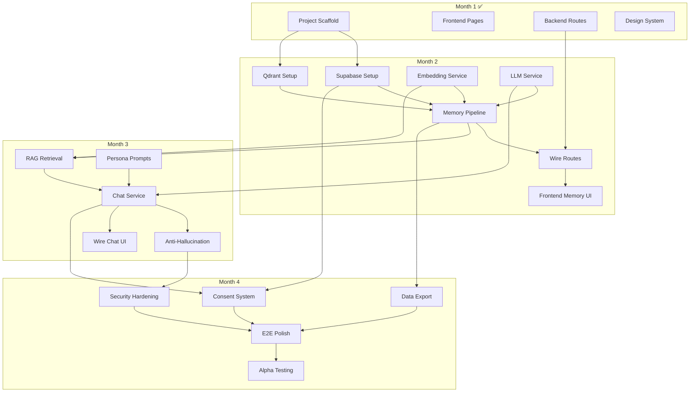

# Implementation Plan — Eternia AI Companion Platform

> Complete phase-by-phase task breakdown for building the full product. Each task includes specific files, dependencies, acceptance criteria, and estimated effort for a **2-person team**.

---

## Table of Contents

1. [Phase 1: MVP — "A Chatbot That Remembers" (Months 1–4)](#phase-1-mvp--a-chatbot-that-remembers-months-14)
2. [Phase 2: V1.1 — "Now It Speaks" (Months 5–7)](#phase-2-v11--now-it-speaks-months-57)
3. [Phase 3: V1.2 — "Now You See Them" (Months 8–10)](#phase-3-v12--now-you-see-them-months-810)
4. [Phase 4: V2 — "Self-Hosted & Sustainable" (Months 11–16)](#phase-4-v2--self-hosted--sustainable-months-1116)
5. [Phase 5: V3 — "Scale & Mobile" (Months 17–24)](#phase-5-v3--scale--mobile-months-1724)
6. [Risk Register](#risk-register)
7. [Dependency Map](#dependency-map)

---

## Phase 1: MVP — "A Chatbot That Remembers" (Months 1–4)

> **Goal:** Text-only chatbot grounded in uploaded memories. Both living and deceased paths. No voice, no avatar.
>
> **Exit Criteria:** 10 internal testers report conversations feel authentic and grounded. <2% hallucination rate.

---

### Month 1: Project Scaffolding ✅ COMPLETE

All tasks in Month 1 are done. See [walkthrough.md](../walkthrough.md) for details.

| Task | Status | Files |
|:---|:---|:---|
| Monorepo setup | ✅ | `README.md`, `.gitignore` |
| Next.js frontend scaffold | ✅ | `frontend/app/*` |
| Design system (CSS) | ✅ | `frontend/app/globals.css` |
| Landing page | ✅ | `frontend/app/page.js` |
| Auth pages (login/signup) | ✅ | `frontend/app/auth/*/page.js` |
| Onboarding flow (6-step) | ✅ | `frontend/app/onboarding/page.js` |
| Chat interface | ✅ | `frontend/app/chat/page.js` |
| FastAPI backend scaffold | ✅ | `backend/app/main.py`, `core/*`, `api/routes/*` |
| Pydantic schemas (13 models) | ✅ | `backend/app/models/schemas.py` |
| Qdrant vector service | ✅ | `backend/app/services/vector_service.py` |
| S3 encrypted storage service | ✅ | `backend/app/services/storage_service.py` |
| Auth middleware (JWT) | ✅ | `backend/app/core/auth.py` |

---

### Month 1.5: Premium Landing Page Redesign (3D Hero)

> **Goal:** Rebuild the landing page into a premium, warm-gradient 3D hero experience that makes Eternia look like a funded startup product, not a side project. Does NOT touch any backend code, auth, or internal pages.
>
> **Exit Criteria:** Landing page loads in <3s, 3D character renders with idle animation + cursor tracking, responsive across all breakpoints, Lighthouse performance ≥ 85.

#### Task 1.5.1: Install 3D & Animation Dependencies
- **Effort:** 0.5 days
- **Owner:** Engineer B
- **Dependencies:** None
- **Commands:**
  ```bash
  npm install @react-three/fiber @react-three/drei three framer-motion
  ```
- **Acceptance Criteria:**
  - [ ] All 4 packages installed and `next build` succeeds
  - [ ] No conflicts with existing React 19 / Next.js 16

#### Task 1.5.2: Build Landing Component Architecture
- **Effort:** 1 day
- **Owner:** Engineer B
- **Dependencies:** Task 1.5.1
- **Files to create:**
  - `frontend/components/landing/Hero.js` — Full hero section (gradient bg + floating card)
  - `frontend/components/landing/NavPill.js` — Floating pill navigation
  - `frontend/components/landing/AvatarCanvas.js` — R3F Canvas + model loader
  - `frontend/components/landing/PlaceholderAvatar.js` — Capsule+sphere procedural fallback
  - `frontend/components/landing/StyleSelector.js` — Right-column circular chips
  - `frontend/components/landing/AvatarThumb.js` — Bottom-right swap thumbnail
  - `frontend/components/landing/Features.js` — Feature cards (extracted from page.js)
  - `frontend/components/landing/HowItWorks.js` — 3-step flow section
  - `frontend/components/landing/Privacy.js` — Privacy promises section
  - `frontend/components/landing/Pricing.js` — Pricing tier cards
  - `frontend/components/landing/CtaBanner.js` — Final CTA gradient banner
  - `frontend/components/landing/Footer.js` — Footer links
- **Acceptance Criteria:**
  - [ ] Each component renders independently
  - [ ] Clean imports, no circular dependencies
  - [ ] Component file names follow `PascalCase.js` convention

#### Task 1.5.3: Build the 3D Avatar Canvas
- **Effort:** 2 days
- **Owner:** Engineer B
- **Dependencies:** Task 1.5.2
- **Files to create/modify:**
  - `frontend/components/landing/AvatarCanvas.js`
  - `frontend/components/landing/PlaceholderAvatar.js`
  - `frontend/public/models/` — Directory for `.glb` files
- **Implementation:**
  - React Three Fiber `<Canvas>` with `dpr={[1, 2]}`, `Suspense` fallback
  - 3-point studio lighting (key: warm white, fill: amber, rim: orange)
  - `@react-three/drei` `Environment` preset `"studio"` + `ContactShadows`
  - Procedural placeholder: capsule body (height 1.6) + sphere head (0.3), warm gradient `MeshStandardMaterial`
  - If `.glb` exists at `/models/avatar.glb`: load via `useGLTF` with Draco decoder
  - Idle breathing: `useFrame` scale oscillation (1.0→1.015, 3s sin wave)
  - Cursor tracking: `onPointerMove` → lerp head rotation (±15° H, ±10° V)
  - `OrbitControls`: horizontal drag only, zoom disabled, pan disabled
  - Tab visibility: `visibilitychange` listener toggles `frameloop` between `"always"` and `"demand"`
- **Acceptance Criteria:**
  - [ ] Placeholder avatar renders if no `.glb` present
  - [ ] Model loads and displays if `.glb` is placed in `/public/models/`
  - [ ] Head follows cursor smoothly
  - [ ] Idle breathing animation visible
  - [ ] Horizontal drag works; zoom and pan disabled
  - [ ] No GPU rendering when tab is hidden

#### Task 1.5.4: Build Hero Layout (Gradient + Card + Columns)
- **Effort:** 1.5 days
- **Owner:** Engineer B
- **Dependencies:** Tasks 1.5.2, 1.5.3
- **Files to modify:**
  - `frontend/app/page.js` — Complete rewrite of hero section; keep scroll sections below
  - `frontend/app/globals.css` — Add `.hero-page` color token overrides + new component classes
- **Implementation:**
  - Full-screen warm gradient background (`linear-gradient(160deg, #FF8C42, #FFB347, #FFF1D0)`)
  - Floating white card: `border-radius: 32px`, `box-shadow: 0 24px 80px rgba(0,0,0,0.12)`
  - 3-column grid inside card: left (text + CTA), centre (3D canvas), right (style selector)
  - Bottom bar: social icons (left), tagline "Memories, brought to life." (centre), avatar thumbnail (right)
  - Pill nav floating above the card
  - `framer-motion` for avatar thumbnail swap: `AnimatePresence` crossfade + accent color transition
- **Acceptance Criteria:**
  - [ ] Hero card is perfectly centred on the gradient
  - [ ] 3-column layout renders correctly at desktop widths
  - [ ] Pill navigation floats at the top of the card
  - [ ] Style selector chips visually respond to clicks (no backend logic)
  - [ ] Avatar thumbnail click triggers model swap animation

#### Task 1.5.5: Responsive Breakpoints & Performance
- **Effort:** 1 day
- **Owner:** Engineer B
- **Dependencies:** Task 1.5.4
- **Files to modify:**
  - `frontend/app/globals.css` — Add `@media` queries for hero components
  - `frontend/components/landing/AvatarCanvas.js` — Add WebGL capability check
  - `frontend/components/landing/NavPill.js` — Add hamburger toggle for mobile
- **Implementation:**
  - **Tablet (768–1023px):** 2-column (text + 3D), selectors move to horizontal scroll row below
  - **Mobile (<768px):** Single column stack, pill nav → hamburger, 3D canvas height capped at 300px
  - WebGL check: if device can't handle Three.js, render static hero image fallback
  - Lazy-load canvas via dynamic `import()` (Next.js `dynamic` with `ssr: false`)
- **Acceptance Criteria:**
  - [ ] Layout looks correct at 1440px, 1024px, 768px, 375px
  - [ ] Mobile hamburger menu opens/closes pill nav
  - [ ] 3D canvas doesn't crash on low-end mobile
  - [ ] Lighthouse performance score ≥ 85 on desktop
  - [ ] `next build` succeeds with no errors

---

### Month 2: Memory Ingestion Pipeline

> **Goal:** Users can upload memories (text, journals, chat exports) and have them parsed, embedded, and stored for retrieval.

#### Task 2.1: Supabase Setup & Database Migration
- **Effort:** 2 days
- **Owner:** Engineer A
- **Dependencies:** None
- **Files to create/modify:**
  - `backend/app/models/database.py` — Supabase client initialization
  - `backend/supabase/migrations/001_initial_schema.sql` — All tables from backend_schema.md
  - `backend/supabase/migrations/002_rls_policies.sql` — All RLS policies
  - `backend/app/core/dependencies.py` — FastAPI dependency injection for Supabase client
- **Acceptance Criteria:**
  - [ ] All 8 tables created in Supabase
  - [ ] RLS policies enforce user isolation
  - [ ] Auto-trigger creates user profile on auth signup
  - [ ] Consent logs are provably append-only (UPDATE/DELETE blocked)

#### Task 2.2: Qdrant Collection Setup
- **Effort:** 1 day
- **Owner:** Engineer A
- **Dependencies:** None
- **Files to create/modify:**
  - `backend/scripts/setup_qdrant.py` — One-time collection + index setup
  - `backend/app/services/vector_service.py` — Add BM25 text index creation
- **Acceptance Criteria:**
  - [ ] `memories` collection exists with 768-dim cosine vectors
  - [ ] Payload indexes on `user_id`, `avatar_id`, `confidence_score`, `content` (text)
  - [ ] BM25 keyword search works alongside dense vector search

#### Task 2.3: Embedding Service
- **Effort:** 2 days
- **Owner:** Engineer B
- **Dependencies:** None
- **Files to create:**
  - `backend/app/services/embedding_service.py`
- **Implementation:**
  - Google `text-embedding-004` integration via API
  - Semantic chunking: 200-token target chunks, 50-token overlap
  - Batch embedding support (up to 50 texts per API call)
  - Content-hash deduplication (don't re-embed identical text)
- **Acceptance Criteria:**
  - [ ] Single text → 768-dim embedding
  - [ ] Batch of 50 texts → 50 embeddings in single API call
  - [ ] Long text (>2000 tokens) automatically chunked and embedded as multiple vectors
  - [ ] Duplicate detection prevents re-embedding same content

#### Task 2.4: LLM Service (Gemini Flash)
- **Effort:** 2 days
- **Owner:** Engineer B
- **Dependencies:** None
- **Files to create:**
  - `backend/app/services/llm_service.py`
- **Implementation:**
  - Gemini 2.5 Flash integration via `google-genai` SDK
  - Structured extraction mode for entity/date/emotion extraction
  - Conversation mode for chat responses
  - Token counting and budget enforcement
  - Error handling and retry logic
- **Acceptance Criteria:**
  - [ ] `extract_metadata(text)` → `{entities, dates, emotions, summary}`
  - [ ] `generate_response(system_prompt, messages)` → response string
  - [ ] Streaming support for chat responses
  - [ ] Proper error handling for rate limits and API errors

#### Task 2.5: Memory Ingestion Pipeline
- **Effort:** 4 days
- **Owner:** Engineer A + B
- **Dependencies:** Tasks 2.1, 2.2, 2.3, 2.4
- **Files to create:**
  - `backend/app/services/memory_service.py`
- **Implementation:**
  - Orchestrates the full pipeline: parse → extract → chunk → embed → store
  - Document parsers for:
    - Plain text (`.txt`)
    - PDF (`.pdf`) via PyPDF2
    - Word documents (`.docx`) via python-docx
    - WhatsApp chat export (custom parser)
    - JSON structured import
  - LLM-based extraction: entities, relationships, dates, emotional tone
  - Confidence scoring based on source quality:
    - `manual` input → 1.0 (user directly wrote it)
    - `journal` → 0.95
    - `chat_export` → 0.85 (may contain casual, less reliable content)
    - `user_contributed` → 0.9 (contributed during conversation)
  - Stores metadata in Postgres + vectors in Qdrant
- **Acceptance Criteria:**
  - [ ] Text input → entities extracted → embedding stored → retrievable via search
  - [ ] WhatsApp export parsed into individual messages with timestamps
  - [ ] PDF text extracted and chunked correctly
  - [ ] Confidence scores assigned correctly by source type
  - [ ] Avatar `memory_count` auto-increments via trigger
  - [ ] Memory limit enforced for free tier (50 memories)

#### Task 2.6: Wire Memory Routes to Pipeline
- **Effort:** 2 days
- **Owner:** Engineer A
- **Dependencies:** Task 2.5
- **Files to modify:**
  - `backend/app/api/routes/memories.py` — Replace TODO stubs with real implementations
  - `backend/app/api/routes/avatars.py` — Wire photo/voice upload to S3
- **Acceptance Criteria:**
  - [ ] `POST /api/memories` ingests a memory end-to-end
  - [ ] `GET /api/memories/{avatar_id}` returns all memories
  - [ ] `POST /api/memories/{avatar_id}/import` handles file upload + parsing
  - [ ] `DELETE /api/memories/{id}` deletes from Postgres + Qdrant
  - [ ] `POST /api/avatars/{id}/photo` uploads to S3 and updates avatar

#### Task 2.7: Frontend — Memory Input UI
- **Effort:** 3 days
- **Owner:** Engineer B
- **Dependencies:** Task 2.6
- **Files to create/modify:**
  - `frontend/lib/api.js` — API client with auth headers
  - `frontend/lib/supabase.js` — Supabase client initialization
  - `frontend/hooks/useAuth.js` — Auth state management
  - `frontend/components/onboarding/StepMemories.js` — Extract from page.js
  - `frontend/app/onboarding/page.js` — Wire to real backend
- **Acceptance Criteria:**
  - [ ] Guided memory prompts submit to backend
  - [ ] Bulk file upload (drag & drop) sends to `/api/memories/{id}/import`
  - [ ] Upload progress indicator
  - [ ] Success/error feedback
  - [ ] Memory count displayed in UI

---

### Month 3: Conversation Engine

> **Goal:** Users can have grounded conversations with their avatar's personality.

#### Task 3.1: RAG Retrieval Pipeline
- **Effort:** 4 days
- **Owner:** Engineer A
- **Dependencies:** Tasks 2.3, 2.5
- **Files to create:**
  - `backend/app/services/retrieval_service.py`
- **Implementation:**
  - Query transformation: HyDE (hypothetical document embedding) + entity extraction
  - Hybrid search: dense vector (Qdrant) + BM25 keyword (Qdrant text index)
  - Reciprocal Rank Fusion to merge results
  - Cross-encoder reranking (use Gemini Flash as reranker in MVP, dedicated model in V2)
  - Confidence gating: only pass memories with score ≥ 0.7
  - Format memories with source attribution for LLM context
- **Acceptance Criteria:**
  - [ ] Query "trip to Goa" retrieves Goa-related memories
  - [ ] BM25 catches keyword matches that vector search misses
  - [ ] Confidence gating filters out low-quality memories
  - [ ] Results include source attribution (file name, date)

#### Task 3.2: Persona Prompt Assembly
- **Effort:** 2 days
- **Owner:** Engineer B
- **Dependencies:** None
- **Files to create:**
  - `backend/app/services/persona_service.py`
  - `backend/prompts/persona_base.yaml`
  - `backend/prompts/grounding_rules.yaml`
  - `backend/prompts/safety_rails.yaml`
- **Implementation:**
  - Dynamic system prompt assembly from:
    1. Base persona (name, traits, catchphrases, speech style)
    2. Grounding rules (hard constraints)
    3. Retrieved memories (injected at query time)
    4. Safety rails (crisis detection, session limits)
    5. Avatar state (living/deceased, relationship context)
  - Persona prompt caching in Redis (1h TTL)
  - Support for versioned prompts (track changes over time)
- **Acceptance Criteria:**
  - [ ] Prompt correctly incorporates avatar personality
  - [ ] Grounding rules are always present
  - [ ] Retrieved memories are formatted with source + date + confidence
  - [ ] Prompt is cached and reused across requests

#### Task 3.3: Chat Service (Full Pipeline)
- **Effort:** 5 days
- **Owner:** Engineer A + B
- **Dependencies:** Tasks 3.1, 3.2, 2.4
- **Files to create:**
  - `backend/app/services/chat_service.py`
- **Implementation:**
  - Full 10-step pipeline:
    1. Verify user access to avatar
    2. Load session context from Redis (last 20 turns)
    3. Transform query (HyDE + entity extraction)
    4. Hybrid retrieval from Qdrant
    5. Rerank and confidence-gate
    6. Assemble system prompt (persona + memories)
    7. Generate response via Gemini Flash
    8. Self-verify grounding (L4 check)
    9. Update session in Redis
    10. Return response with metadata
  - Session management (Redis): last 20 turns, 24h TTL
  - Emotional state tracking (basic sentiment)
  - Streaming response support (SSE or WebSocket)
- **Acceptance Criteria:**
  - [ ] User sends message → receives grounded response
  - [ ] Response cites retrieved memories internally
  - [ ] Memory gaps produce graceful refusals, not fabrications
  - [ ] Session context maintained across multiple messages
  - [ ] Response includes `grounded` flag and `memories_used` count

#### Task 3.4: Anti-Hallucination Layers L1–L3
- **Effort:** 3 days
- **Owner:** Engineer A
- **Dependencies:** Task 3.3
- **Files to modify:**
  - `backend/app/services/chat_service.py` — Add verification steps
  - `backend/prompts/grounding_rules.yaml` — Refine constraints
- **Implementation:**
  - **L1 (Prompt):** Hard constraint in system prompt
  - **L2 (Retrieval Gate):** Confidence threshold enforcement
  - **L3 (Citation Contract):** LLM must reference memory IDs for claims
  - Self-reflection pass: second LLM call checks if response is entailed by context
  - Uncertainty routing: low confidence → graceful refusal
- **Acceptance Criteria:**
  - [ ] Run 200+ test queries from hallucination benchmark
  - [ ] <2% hallucination rate on grounded queries
  - [ ] 100% of unknown-topic queries produce graceful refusals
  - [ ] No response fabricates specific events, people, or dates

#### Task 3.5: Wire Chat Routes + Frontend
- **Effort:** 3 days
- **Owner:** Engineer B
- **Dependencies:** Tasks 3.3, 3.4
- **Files to modify:**
  - `backend/app/api/routes/chat.py` — Replace stubs
  - `frontend/app/chat/page.js` — Wire to real backend
  - `frontend/hooks/useChat.js` — Chat state management
  - `frontend/components/chat/MessageBubble.js` — Grounding badge component
- **Acceptance Criteria:**
  - [ ] Real-time chat with streaming responses
  - [ ] Grounding indicator on each message (green/yellow)
  - [ ] Chat history preserved in session
  - [ ] Loading/typing states work correctly

---

### Month 4: Consent, Security & Polish

> **Goal:** Production-ready consent flow, encryption audit, data export, and onboarding polish.

#### Task 4.1: Consent System Implementation
- **Effort:** 4 days
- **Owner:** Engineer A
- **Dependencies:** Task 2.1
- **Files to modify:**
  - `backend/app/api/routes/consent.py` — Full implementation
  - `backend/app/api/routes/avatars.py` — Consent check before chat
- **Files to create:**
  - `backend/app/services/consent_service.py`
- **Implementation:**
  - Living path: self-consent with email verification
  - Deceased path: family attestation + 72h cooling period
  - Consent tier management (text → voice → full avatar)
  - Revocation workflow: deactivate avatar → delete data → retain audit log
  - Append-only enforcement verified (UPDATE/DELETE triggers block modifications)
- **Acceptance Criteria:**
  - [ ] Living user can consent for themselves
  - [ ] Deceased path requires attestation + enforces 72h cooling
  - [ ] Revocation deletes all media, vectors, and session data
  - [ ] Consent log cannot be modified or deleted
  - [ ] Avatar cannot be chatted with if consent is pending/revoked

#### Task 4.2: Frontend Consent Ceremony
- **Effort:** 2 days
- **Owner:** Engineer B
- **Dependencies:** Task 4.1
- **Files to modify:**
  - `frontend/app/onboarding/page.js` — Wire consent step to backend
  - `frontend/components/onboarding/StepConsent.js`
- **Acceptance Criteria:**
  - [ ] Both checkboxes required before proceeding
  - [ ] Living path shows invitation flow message
  - [ ] Deceased path shows relationship proof input
  - [ ] Error states handled (server rejection)

#### Task 4.3: Data Export Feature
- **Effort:** 2 days
- **Owner:** Engineer A
- **Dependencies:** Tasks 2.1, 2.5
- **Files to create:**
  - `backend/app/api/routes/export.py`
  - `backend/app/services/export_service.py`
- **Implementation:**
  - Generate ZIP file containing:
    - All photos (decrypted from S3)
    - All voice recordings (decrypted from S3)
    - All memories as JSON + human-readable TXT
    - Chat history as JSON
    - Avatar profile as JSON
  - ZIP stored temporarily in S3 with 24h presigned URL
- **Acceptance Criteria:**
  - [ ] User clicks "Export Data" → ZIP download link generated
  - [ ] ZIP contains all user data in readable formats
  - [ ] Temporary files cleaned up after 24h

#### Task 4.4: Frontend Settings & Export Page
- **Effort:** 2 days
- **Owner:** Engineer B
- **Dependencies:** Task 4.3
- **Files to create:**
  - `frontend/app/settings/page.js`
- **Acceptance Criteria:**
  - [ ] Settings page with account info, plan, data management
  - [ ] "Export All Data" button triggers export and shows download link
  - [ ] "Delete Account" with confirmation modal
  - [ ] Consent management UI (view status, revoke)

#### Task 4.5: Security Hardening & Error Handling
- **Effort:** 3 days
- **Owner:** Engineer A + B
- **Dependencies:** All previous tasks
- **Files to create/modify:**
  - `backend/app/core/errors.py` — Custom exception classes
  - `backend/app/core/middleware.py` — Rate limiting, request logging
  - `backend/app/main.py` — Global error handlers
- **Implementation:**
  - Rate limiting: 30 req/min chat, 10 req/5min upload, 5 req/min auth
  - Request logging (IDs and metadata only, no PII)
  - Global error handler returning consistent error format
  - File upload validation (magic bytes, not just MIME type)
  - Input sanitization on all text fields
- **Acceptance Criteria:**
  - [ ] Rate limiting enforced and returns 429 with retry-after
  - [ ] All errors return `{"error": {"code", "message", "status"}}` format
  - [ ] No PII in server logs
  - [ ] Malicious file uploads rejected

#### Task 4.6: End-to-End Onboarding Polish
- **Effort:** 3 days
- **Owner:** Engineer B
- **Dependencies:** All previous frontend tasks
- **Files to modify:**
  - All onboarding components
  - `frontend/app/chat/page.js`
- **Acceptance Criteria:**
  - [ ] Full flow: signup → onboarding → consent → upload → training → first chat
  - [ ] Loading states on every async operation
  - [ ] Error states with compassionate messaging
  - [ ] Empty states with helpful guidance
  - [ ] Responsive design works on tablet and mobile viewports

#### Task 4.7: Internal Alpha Testing
- **Effort:** 5 days
- **Owner:** Both
- **Dependencies:** All Month 4 tasks
- **Implementation:**
  - Deploy to staging (Vercel + Railway)
  - Recruit 10 internal testers (friends, family)
  - Each tester creates an avatar and has 5+ conversations
  - Collect feedback via simple form (Google Forms)
  - Track: authenticity, grounding, emotional safety, UX friction
- **Acceptance Criteria:**
  - [ ] 10 testers completed full flow
  - [ ] >80% report "felt authentic" in conversations
  - [ ] <2% reported hallucinated memories
  - [ ] All critical bugs filed and fixed

---

## Phase 2: V1.1 — "Now It Speaks" (Months 5–7)

> **Goal:** Add voice cloning via ElevenLabs API. Users hear their loved one's voice.
>
> **Exit Criteria:** 30 beta users. >75% say voice adds meaningful emotional value.

#### Task 5.1: ElevenLabs Voice Integration
- **Effort:** 4 days
- **Files to create:** `backend/app/services/voice_service.py`
- **Implementation:**
  - Clone voice from uploaded audio (ElevenLabs API)
  - Text-to-speech with cloned voice
  - WebSocket streaming for real-time audio
  - Placeholder voice for users without audio (neutral, warm tone)
  - Speaker embedding caching in Redis

#### Task 5.2: Voice Recovery Assistant Backend
- **Effort:** 2 days
- **Files to create:** `backend/app/services/audio_processing.py`
- **Implementation:**
  - Audio format detection and transcoding (any format → WAV)
  - Noise reduction preprocessing
  - Duration validation (min 5s)
  - Audio quality scoring

#### Task 5.3: Frontend Voice UI
- **Effort:** 3 days
- **Files to modify:** `frontend/app/chat/page.js`, onboarding voice step
- **Implementation:**
  - Audio player for voice responses
  - Play/pause/replay controls
  - Voice upload with preview
  - Voice Recovery Assistant UI (already partially built)

#### Task 5.4: Session Memory (Redis Integration)
- **Effort:** 2 days
- **Files to modify:** `backend/app/services/chat_service.py`
- **Implementation:**
  - Full Redis session management (last 20 turns)
  - Emotional state tracking (basic sentiment analysis)
  - Session persistence across page refreshes

#### Task 5.5: Crisis Detection & Warm Handoff
- **Effort:** 3 days
- **Files to create:** `backend/app/services/safety_service.py`
- **Implementation:**
  - Keyword + LLM-based crisis detection
  - Gentle character break when crisis detected
  - Warm handoff buttons to therapy partners (BetterHelp, Amaha)
  - Localized crisis helpline display
  - Session limit nudges after extended use

#### Task 5.6: Anti-Hallucination Layers L4–L5
- **Effort:** 3 days
- **Files to modify:** `backend/app/services/chat_service.py`
- **Implementation:**
  - L4: Self-reflection pass (second LLM call for verification)
  - L5: Uncertainty routing (low confidence → graceful refusal)
  - Production logging for groundedness monitoring

#### Task 5.7: Private Beta Launch
- **Effort:** 5 days
- **Implementation:**
  - Deploy to production (Vercel + Railway)
  - Invite 30–50 families via waitlist
  - Set up monitoring (Sentry, LangSmith)
  - Collect NPS and qualitative feedback
  - Bug triage and fix cycle

---

## Phase 3: V1.2 — "Now You See Them" (Months 8–10)

> **Goal:** Add animated avatar via HeyGen API. Full monetization launch.
>
> **Exit Criteria:** 100+ paying users. $1,000+ MRR.

#### Task 8.1: HeyGen Avatar Integration
- **Effort:** 5 days
- **Files to create:** `backend/app/services/avatar_service.py`
- **Implementation:**
  - Photo → animated avatar via HeyGen API
  - Lip-synced to voice output
  - Video streaming to frontend

#### Task 8.2: Frontend Avatar Display
- **Effort:** 4 days
- **Files to create:** `frontend/components/chat/AvatarVideo.js`
- **Implementation:**
  - Video player for avatar responses
  - Fallback to voice-only if avatar generation fails
  - Smooth transitions between text/voice/avatar modes

#### Task 8.3: Monetization (Stripe Integration)
- **Effort:** 5 days
- **Files to create:**
  - `backend/app/services/billing_service.py`
  - `backend/app/api/routes/billing.py`
  - `frontend/app/pricing/page.js`
  - `frontend/app/settings/billing/page.js`
- **Implementation:**
  - Stripe subscription management (3 tiers + Eternal Memorial)
  - Plan enforcement on backend (memory limits, feature gates)
  - 30-day free trial on signup
  - Hardship program application form
  - Billing settings page (upgrade, downgrade, cancel)

#### Task 8.4: Eternal Memorial Pages
- **Effort:** 3 days
- **Files to create:** `frontend/app/memorial/[id]/page.js`
- **Implementation:**
  - Public shareable memorial page
  - Photo gallery, curated memories, optional guest interaction
  - QR code generation for gravestones/physical locations
  - SEO-optimized for memorial discoverability

#### Task 8.5: Public Launch
- **Effort:** 5 days
- **Implementation:**
  - Marketing landing page polish
  - SEO content (blog posts about grief tech, memory preservation)
  - Partnership outreach (hospice, funeral homes, elder care)
  - ProductHunt / HackerNews launch
  - Monitoring, alerting, on-call rotation

---

## Phase 4: V2 — "Self-Hosted & Sustainable" (Months 11–16)

> **Goal:** Migrate to self-hosted AI models. Client-side rendering. Knowledge graph. Sustainable unit economics.
>
> **Exit Criteria:** <$0.03/conversation cost. <200ms voice TTFB. 500+ paying users.

#### Tasks 11–12: Self-Hosted Voice
- Migrate from ElevenLabs → self-hosted Chatterbox on L40S GPU
- Set up GPU infrastructure (reserved baseline + Modal burst pool)
- FP8 quantization for VRAM optimization
- Speaker embedding caching and warm pool

#### Tasks 13–14: Self-Hosted Avatar + Client-Side Rendering
- Migrate from HeyGen → LivePortrait + MuseTalk pipeline
- Build Three.js + MediaPipe client-side rendering SDK
- Stream expression coefficients via WebSocket (10-15 KB/s)
- Quality benchmarking against HeyGen output

#### Task 15: Knowledge Graph (Zep/Graphiti)
- Integrate temporal knowledge graph for multi-hop reasoning
- Temporal queries: "When did we move?" "What happened last Diwali?"
- Relationship mapping between entities in memories
- Layer L6 monitoring: production groundedness tracking

#### Task 16: Family Sharing + B2B API
- Family sharing: invite up to 5 members, permission levels
- B2B API: white-label endpoints for funeral home integration
- AI-generated Memory Books (PDF generation from memories)

---

## Phase 5: V3 — "Scale & Mobile" (Months 17–24)

> **Goal:** Mobile app, multi-language, enterprise partnerships, team growth.

- React Native mobile app with Kokoro for edge voice synthesis
- Multi-language support (voice + chat)
- "Digital Will" self-service feature
- Video memory ingestion (auto-extract voice + face + transcript)
- Enterprise partnerships with funeral homes, hospice, elder care
- **Hire 3–5 more engineers** — revenue should justify expansion by now

---

## Risk Register

| Risk | Likelihood | Impact | Mitigation |
|:---|:---|:---|:---|
| **Hallucination in production** | Medium | Critical | 6-layer defense, benchmark suite, live monitoring |
| **Negative PR (deepfake accusations)** | Medium | High | Strong consent system, C2PA watermarking, transparent disclosure |
| **User emotional dependency** | High | Medium | Session limits, therapist handoff, retirement protocol |
| **ElevenLabs/HeyGen API cost spike** | Medium | Medium | Self-hosting migration planned for V2 (Months 11–14) |
| **Data breach** | Low | Critical | AES-256, RLS, zero-trust, no PII in logs, security audit |
| **Team burnout (2 engineers)** | High | High | Strict scope per phase, no multi-week branches, async work |
| **Low retention / LTV** | Medium | High | Eternal Memorial anchor, family sharing, Memory Day re-engagement |
| **Regulatory changes** | Medium | Medium | Modular consent system, region-ready data architecture |

---

## Dependency Map



---

## Summary Metrics

| Phase | Duration | Key Deliverable | Revenue Trigger |
|:---|:---|:---|:---|
| **Phase 1 (MVP)** | Months 1–4 | Text chatbot + memory RAG | None (internal testing) |
| **Phase 2 (V1.1)** | Months 5–7 | + Voice conversations | Private beta (free) |
| **Phase 3 (V1.2)** | Months 8–10 | + Animated avatar + monetization | **Public launch, first revenue** |
| **Phase 4 (V2)** | Months 11–16 | Self-hosted AI, client rendering | Cost reduction → profitability |
| **Phase 5 (V3)** | Months 17–24 | Mobile app, enterprise, scale | Revenue growth → hire team |
