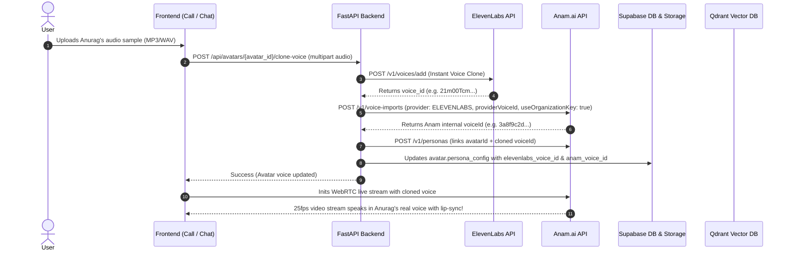

# Voice Cloning & Multi-Avatar Video Call Architecture Plan

## Executive Summary
This plan details the end-to-end integration of **ElevenLabs Instant Voice Cloning** with **Anam.ai Photorealistic Digital Humans**, enabling companions to look AND sound exactly like real people (such as Anurag). It also adds in-call avatar creation and a direct video call trigger from the chat interface, backed by persistent semantic memories in Qdrant.

---

## 1. Verified Feasibility & Architecture

### A. ElevenLabs to Anam.ai Voice Flow

---

## 2. Key Features to Implement

### Feature 1: Clone Anurag's Real Voice
- **Audio Upload / Record:** Upload an audio file (MP3/WAV/M4A) or record directly using the microphone in browser.
- **Backend Voice Service:**
  - `POST https://api.elevenlabs.io/v1/voices/add` clones the voice into the user's ElevenLabs Starter account (30,000 credits, 10 custom voice slots).
  - `POST https://api.anam.ai/v1/voice-imports` imports the ElevenLabs voice into Anam using the saved organization key (`sk_51c5b7...` verified & active).
- **Update Existing Avatar:** Added a "Voice" action in the video call header so Anurag's voice can be cloned and linked immediately!

### Feature 2: In-Call Avatar Creator Modal
- **Location:** Top navigation bar of `frontend/app/call/page.js`.
- **UI Elements:**
  - Avatar Switcher Dropdown (switch between companions without leaving `/call`).
  - `+ New Avatar` button opening a modern glassmorphic creation modal:
    1. **Name & Relationship** (e.g. Anurag, Friend).
    2. **Photo Upload** (face portrait, auto-generates Anam Cara-4 avatar).
    3. **Voice Audio Upload** (MP3/WAV/recording, auto-clones via ElevenLabs & imports to Anam).
    4. **Initial Memories / Bio** (preserves background lore in Qdrant & Supabase).
- **Instant Activation:** Once created, the call seamlessly switches to the new avatar and starts streaming their 25fps digital human.

### Feature 3: Chat Video Call Option & Memory Continuity
- **Chat Header Video Call Button:**
  - Add a dedicated `<Link href={"/call?avatarId=" + activeAvatar.id}>` with video camera icon in `frontend/app/chat/page.js`.
- **Memory Continuity:**
  - All memories saved in chat (Stories, + Add Memory) are stored in Qdrant vector database.
  - When the user speaks in the video call, Gemini retrieves memories from Qdrant via semantic search and injects them into the companion's prompt, ensuring they remember all shared experiences.

---

## 3. Implementation Steps

### Step 1: Backend Services & API Routes
- [ ] Add `create_instant_voice_clone` in `backend/app/services/voice_service.py`.
- [ ] Add `import_elevenlabs_voice` in `backend/app/services/anam_service.py`.
- [ ] Implement `POST /api/avatars/create-with-media` in `backend/app/api/routes/avatars.py` (atomic creation of avatar + photo upload + Anam avatar + ElevenLabs voice clone + Anam persona + Qdrant memory).
- [ ] Implement `POST /api/avatars/{avatar_id}/clone-voice` in `backend/app/api/routes/avatars.py` (clone voice for existing avatar like Anurag).

### Step 2: Frontend API Client
- [ ] Add `api.createAvatarWithMedia(formData)` in `frontend/lib/api.js`.
- [ ] Add `api.cloneAvatarVoice(avatarId, audioFile)` in `frontend/lib/api.js`.

### Step 3: Video Call Page Enhancements
- [ ] Add `AvatarVoiceUpload` modal component in `frontend/components/chat/AvatarVoiceUpload.js` (file upload + live microphone recorder).
- [ ] Add `CreateAvatarModal` in `frontend/components/chat/CreateAvatarModal.js`.
- [ ] Add "Voice" trigger button and "+ New Companion" button + switcher dropdown in `frontend/app/call/page.js`.

### Step 4: Chat Page Integration
- [ ] Add "Video Call" button in chat header next to "Stories" and "Add" in `frontend/app/chat/page.js`.
- [ ] Verify seamless transition from Chat to Video Call with memory preservation.

### Step 5: Verification & Testing
- [ ] Test voice cloning with audio sample.
- [ ] Test in-call companion creation.
- [ ] Test video call launching directly from chat.
